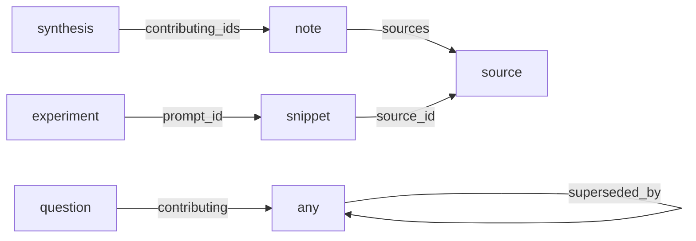

# Reference

The README explains what research-vault is and how to start. This page is for looking things up. It is a command overview with the flags you'll actually reach for. Running `research-vault` with no arguments prints the command list; the test suite is the complete contract.

## Scope

research-vault is for *external* facts: documentation, API behaviour, tool-version claims and the decisions you made because of them. It is not a code indexer beyond the comments that cite the vault, and does not replace the agent's view of your repo. Without Node, an agent can still read a vault by globbing and grepping the folders; the CLI is the faster, checked path.

## Where the vault lives

Tooling and vault data are separate by default. The vault is discovered in order:

1. `--vault <path>` flag
2. a repo's `.research-vault.json` (project binding, below)
3. `$RESEARCH_VAULT_PATH`
4. the config pointer `init` writes when it sets the default vault (first `init`, or `--set-default`)
5. the OS default: `$XDG_DATA_HOME/research-vault` (else `~/.local/share/research-vault`) on Linux, `~/Library/Application Support/research-vault` on macOS, `%LOCALAPPDATA%\research-vault` on Windows

## Skills and slash commands (Claude Code)

Skills load when a request matches their job; none of them fires for every technical question.

| Skill | Job |
|---|---|
| `research-vault-usage` | Searching, citing with a freshness check, planning the entries a synthesis needs |
| `research-capture` | Writing a new entry by hand, with the dedup and conflict-review steps |
| `research-verify` | Walking through re-checking a stale entry |
| `research-librarian` | Read-only curation guidance |
| `research-orchestrate` (`/research`) | A fresh research task end to end: vault first, then the web, every finding filed as entries |
| `research-authoring` | Fires when a citation is about to land in prose you're writing in a vault-bound repo |
| `research-review` | Auditing an existing document or corpus against the vault |
| `research-teach` | Teaching a topic over sessions: resources and facts in the vault, probed evidence, lessons checked by `teach lint`, read by a fresh `lesson-reader` agent, then gated by a fresh `claims-reviewer` agent, quiz attempts recorded by a local quiz server (`teach serve`) |
| `research-claims-gate` | Gating a draft that cites the vault: derives the evidence list, dispatches one fresh `research-vault:claims-reviewer`, records the verdict in the claims ledger |

Slash commands, all under `/research-vault:`: `research-init`, `research-search`, `research-related`, `research-lint`, `research-compile`, `research-obsidian`, `research`. Every skill is also `/research-vault:<name>` (for example `/research-vault:research-capture`).

## Binding a repo to a vault

Run `init --project` at the root of a repo to write `.research-vault.json` there, and commit it. From then on:

- **Discovery.** Every CLI command run from inside the repo resolves to that vault with no flag or env var. Agents that read the vault's `AGENTS.md` follow it; the binding selects the vault, it does not control an agent's behaviour.
- **`research-authoring`.** When a citation is about to land in prose you're writing in the repo, the skill consults the vault, captures what's missing and checks freshness first.
- **`check`.** Audits the repo's docs against the vault; each citation is `ok`, `stale` or `uncovered`. `check --check` exits non-zero so CI can fail on stale or uncovered citations.
- **Gate.** Lessons and reference docs in every teach workspace (a directory holding `MISSION.md`) found under the repo are gated, plus any file matching the optional `gates.globs` array in `.research-vault.json`, for example `"gates": { "globs": ["docs/**/*.md"] }`. The `research-claims-gate` skill records each verdict with `gate record` in `.research-vault-ledger.jsonl` at the repo root, keyed to the file's content hash, so an edit after the gate needs a new verdict. The Stop hook blocks a turn that leaves a changed gated file without a `PASS` or `MERIT` row for its current content. After an edit to a gated file or one matching `references.globs`, a hook reports its uncovered or stale citations without blocking; an edit inside the vault runs `lint --fix` instead, so this applies to files outside the vault. `gate status <file> --check` exits 1 when the current content has no passing verdict. A vault entry outside any bound repo can be gated too; its ledger lives in the vault.

### Code links

A vault id on a comment line of its own, above a column-0 declaration, cites that entry for the symbol below it. The id may carry a pin, `<id>@<key>=<version>`, naming a key of `code.versions` and the version the code was checked against:

```lua
-- Sleep-mode call order per 2026-03-03-sleep-mode-api@sdk=0.20
function ns.Sleep(frame)
```

Blank and comment lines may sit between the comment and the declaration; several ids on one line, or several comment lines above one declaration, are several links to the same symbol. A link whose next non-blank, non-comment line is not a column-0 declaration is `unattached`: reported, never dropped.

**Opt-in.** `init --project --vault <relative dir> --code-links '<glob>[,<glob>]'` writes the standard binding plus a `code` block, and a `code` block written by hand into an existing binding is the same opt-in. The block is accepted only on a relative `vault` inside the repo: an absolute, empty, `..` or absent vault is rejected with `code links need a project-specific vault inside the repo (a relative vault path); this binding points at <vault>`. Without the block, every command and hook runs exactly as before and the comments are ordinary comments.

```json
"code": {
  "globs": ["src/**/*.lua"],
  "languages": {},
  "versions": {
    "sdk": { "file": "package-lock.json", "pattern": "\"node_modules/sdk\": \\{\\s*\"version\": \"([^\"]+)\"" }
  }
}
```

- **`versions`.** Each key names a `{ file, pattern }`. The pattern is a JavaScript regex applied with the `m` flag to the whole file; the first capture group of the first match is the declared version. A file that is missing or that the pattern does not match is a configuration error (`check` exits 2 with `versions.<key>: pattern matched nothing in <file>`), not a row per link. `package-lock.json` nests the installed version under `packages[<path>].version`; an addon `.toc` (`## Interface:`), a `go.mod` `require` line and `build.zig.zon` (`.minimum_zig_version`) hold it on one line. `check` prints the values it read as a footer, `versions: sdk=0.20`.
- **`languages`.** A language is `{ comment, decl }`, two regex sources: `comment` matches one whole comment line and captures its text in group 1; `decl` matches one column-0 declaration line and captures the symbol name in its first non-empty group. Each must compile and hold a capture group, else the error names the field (`code.languages[".py"].decl: pattern has no capture group`). The plugin ships one row, `.lua`:

  ```js
  comment: /^\s*--(?!\[=*\[)(.*)$/,
  decl: /^(?:local\s+)?function\s+([A-Za-z_][\w.:]*)\s*\(|^(?:local\s+)?([A-Za-z_][\w.]*)\s*=(?!=)/,
  ```

  A project adds any other language as a row keyed by extension in `code.languages`, and may override a shipped row; a `code.globs` file whose extension has a row from neither is a configuration error, `no language for .py in code.globs; add code.languages[".py"] = { comment, decl }`. `comment` is matched line by line, so a block-only comment syntax needs a line prefix inside the block.
- **Statuses.** A code row is `ok`, `uncovered` (no entry for the id), `unattached`, or `stale` with its reason: `(time)` for an unpinned link whose entry is past its volatility window, or a pinned link to a `volatile` entry; `(superseded by <id>)` for an entry with `status: superseded`; `(<key> <pinned> -> <declared>)` for a pin that differs from the declared version; `(no key <key> in code.versions)`. A pin selects the version rule over the time rule; an unpinned link follows the entry's window as prose does. `check --check` exits 1 on any `stale`, `uncovered` or `unattached` row.
- **Gate.** Each linked declaration is a unit, `sym:<name>`, hashed from its leading comment block to the line before the next column-0 declaration's comment block, with pin values stripped, so moving the block, editing a neighbour or moving a pin reopens nothing and editing the body does. Code files with an attached link are gated like `gates.globs` files; `gate evidence <file> --changed` adds one line per changed unit, `unit sym:<name> <file>:<start>-<end> <status>`, which the `claims-reviewer` reads as its line range. The post-edit hook reports a code file's non-`ok` rows and, after an edit to a `versions` file, every link whose pin differs from the version now declared. The Stop hook also blocks a turn in which a `versions` file changed and a link is still pinned to another value, naming the link and the two versions.

## Extending the controlled vocabulary

The schema enums are small on purpose. A vault that needs its own terms (a lab recording `lab-run` as a verification method, a team with an extra `domain`) adds them in `.research-vault.json`:

```json
{
  "vault": "research",
  "taxonomy_extensions": {
    "verification_method": ["experiment", "lab-run"],
    "verification_result": ["partial"]
  }
}
```

- **Additive only.** You can add values, never remove or redefine a built-in, so entries stay portable between vaults.
- **Extensible fields:** `domain`, `confidence`, `outcome`, `question_state`, `verification_method`, `verification_result`. The map-valued taxonomy (`volatility`, `stage_by_folder`, `topic_aliases`) is not extensible, and `topics:` already accepts any tag.
- **Keyed on the vault**, not your shell's working directory, so the vocabulary is the same wherever a command runs.

To change the built-in vocabulary itself, edit `schema/taxonomy.json`. The linter, `capture`, the generated `AGENTS.md` and each vault's copied `taxonomy.json` all derive from it.

## Freshness

Each entry has a `volatility` tier with a review interval. An entry is stale when its last confirming verification is older than the interval.

| tier | covers | interval |
|---|---|---|
| `stable` | fundamentals, algorithms, classics | 3 years |
| `slow` | established practices, mature frameworks | 1 year |
| `fast` | specific tool APIs, framework versions, LLM capabilities | 90 days |
| `volatile` | pricing, rate limits, current best model, availability | always re-check |

A note or synthesis is only as fresh as its evidence; `advise` reports conclusions whose source chain reaches a stale or replaced entry.

## Versions and replacements

These are different things:

- **A new version of a tool is new knowledge, not a correction.** `vcluster 0.19` and `0.20` are two active entries sharing a `series`. Record this with `verify --succession` on the older entry, then capture the newer version as its own source with `--subject-name`, `--subject-version` and `--series`.
- **A replacement is for an entry that is wrong or obsolete.** Capture the corrected entry first, then `verify --id OLD --method <method> --result outdated --superseded-by NEW`. The old entry stays on disk with `status: superseded`; `search` hides it unless `--include-superseded`, and `related` still shows it so the evidence trail stays visible.

## Entry types and the graph

| Folder | Holds | Create one when |
|---|---|---|
| `sources/` | Raw captures of external material, as-is | you clip something worth keeping |
| `notes/` | Your distilled take on one or more sources: the load-bearing claims and how you'd use them | you read a source and want a durable, skimmable version |
| `synthesis/` | Conclusions drawn across several entries | you see a pattern worth stating once |
| `snippets/` | Reusable code or prompt fragments | you have a fragment you'll reuse |
| `experiments/` | Logged trial runs with task, parameters and outcome | you run a trial worth recording |
| `questions/` | Open questions (`open → investigating → answered`) | you hit something to track and answer over time |

Distillation (source → note → synthesis) is a deliberate step; nothing auto-promotes. A synthesis usually cites notes, and may also cite sources, experiments, questions and snippets directly; a factual rollup (a release-note matrix, a version diff) may skip notes if it declares `synthesis_basis: primary-rollup`.

Stored references point from the declaring entry to what it references:



`.vault-manifest.json` lists every reference as a typed edge and inverts the backlink-forming ones. Each vault's generated `AGENTS.md` §5 documents the fields and §5.2 maps graph questions to commands.

Two facet tiers keep retrieval clean as a vault grows: **`domain`** is a small controlled set of broad areas (`software-engineering`, `systems-infrastructure`, `data-ml`, `security`, `learning`, `llm-assisted-dev`, `meta`); **`topics`** is freeform and is where specific tech lives.

## Commands

Run as `node bin/research-vault.mjs <command>` from a clone, or `research-vault <command>` if you've put it on your PATH. Every command takes `--vault <path>`. For example:

```text
research-vault capture --type source --title "vcluster sleep mode" \
  --url https://docs.vcluster.com/sleep-mode --domain systems-infrastructure \
  --topics kubernetes,vcluster --subject-name vcluster --subject-version 0.20
research-vault search --topic vcluster
research-vault verify --id <id> --method refetched-source --result confirmed
```

Ids are `<date>-<slug>`; use the one `capture` or `search` prints rather than guessing it.

| Command | Does |
|---|---|
| `init` | Scaffold a vault and generate its `AGENTS.md`. `--project` binds the current repo; with `--code-links '<glob>[,<glob>]'` it also writes the `code` block, which needs a relative `--vault` inside the repo. `--refresh-docs` regenerates `AGENTS.md` and `taxonomy.json` in an existing vault and touches nothing else (entries and `meta/` are preserved). |
| `capture` | Add an entry. Required: `--type`, `--title`; sources also `--url`. Common: `--domain`, `--topics a,b`, `--subject-name`/`--subject-version`/`--series`, `--summary`, `--sources` (notes), `--contributing-ids` (syntheses), `--confidence`. Dedupes by URL and version. `--scaffold` writes a per-type body skeleton; `--body-file` supplies prose for non-source types; `--content-file` and `--captured-via` record local provenance; `--store-body` keeps the text you pass with `--content` or `--content-file` in a source entry and needs `--ack-data-egress`; capture never fetches the URL itself. `--batch <plan.json>` validates every entry before writing any, reports duplicates as skipped, and writes sequentially (a validation failure writes nothing; a filesystem failure can leave partial output). |
| `lint` | Validate the vault and rebuild the manifest. `--check` for CI (exits non-zero on violations or a stale manifest); `--fix` applies safe normalizations. |
| `verify` | `--stale` lists entries past their interval. `--id <id> --method <m> --result <r> [--notes]` records a check. `--result outdated --superseded-by <id>` replaces; `--succession` records a version sibling. |
| `search` | `--type`, `--domain`, `--topic`, `--series`, `--text` (title, topics, summary), `--body`, `--json`. Superseded entries are hidden unless `--include-superseded`. |
| `related` | Typed links for an entry. `--depth N`, `--direction` (`out`, `in` or `both`), `--rel a,b`, `--format mermaid`. |
| `advise` | Read-only report: stale entries, stale evidence chains, orphans, sources without notes, unverified sources, missing summaries, aliasable topics, stub bodies, quote residue. `--json`. |
| `manifest` | Rebuild or print the derived index. |
| `compile` | Regenerate the human-readable `_index/` (git-ignored, derived). |
| `obsidian` | Regenerate `_obsidian/` (git-ignored, derived). Open that folder, not the vault root, as an Obsidian vault; stubs carry `type/`, `status/`, `domain/`, `volatility/`, `freshness/` and `topic/` tags, so a graph filter like `tag:#freshness/stale` colours what matters. |
| `check` | Audit a document or glob outside the vault. `--report` or `--json` emit a coverage matrix; `--check` exits non-zero on a stale or uncovered citation. URLs and ids inside code spans and fenced blocks are not citations; a value found only in code is reported as skipped. A fence left unclosed makes the rest of the file code, and `check` lists a URL found only there as skipped. With a `code` block in the binding, files matching `code.globs` are read for code links instead (one row per link, printed as `file:line symbol`), the summary gains the `unattached` and code-link counts, and a `versions:` footer lists the declared versions; with no positional glob, `references.globs` and `code.globs` are both checked. Read-only, no network. |
| `gate` | `gate evidence\|record\|status`: derive a draft's evidence list from the vault (`evidence <draft> [--extra <ids>] [--json]`), record a claims verdict keyed to the file's content hash (`record <file> <PASS\|FAIL-as-sent\|MERIT> [note]`), or report the verdict for the current content (`status <file> [--check]`, exit 1 with `--check` when there is no `PASS` or `MERIT`). |
| `teach` | Teaching workspace verbs: `teach record add --title <t> --kind <k> [--lesson <id>] [--body-file <path>] [workspace]`, `teach record supersede <id> --by <id> [--reason <text>] [workspace]`, `teach attempt add --lesson <id> --answers <comma list> [workspace]`, `teach lint [--fix] [workspace]` (prints `lint: clean` or the findings, exit 1 on any non-warning finding), `teach next [workspace]` and `teach serve [workspace]`. The workspace is the positional path, which must hold `MISSION.md`, else the cwd when it holds `MISSION.md`; otherwise usage and exit 2. `serve` binds `127.0.0.1` only; its limits are in [SECURITY.md](../SECURITY.md). |
| `refresh` | Re-fetch sources to see whether they changed; reports `confirmed`, `changed` or `unreachable` per source and never edits entries. Run `verify` on anything `changed`. Needs `RESEARCH_VAULT_ALLOW_NETWORK=1`. |
| `export` | JSONL for fine-tuning or eval, to stdout or `--out <path>` (outside the vault). Default: answered-question pairs. `--scope <types>` chooses which types to export instead (include `question` to keep the pairs); other types emit title and summary, and bodies need `--include-bodies --ack-data-egress`. See [FINETUNING.md](FINETUNING.md). |

Four operations require a command rather than prose, by design: `lint` (correctness is checked, not asserted), `init`, `refresh` (network opt-in) and `export` (leaves the vault).

## Safety: network and egress

These guarantees are about the CLI. The agent hosting it may search or fetch the web on its own; that is governed by the agent, not by this tool.

- Ordinary commands (`capture`, `verify`, `lint`, `init`, `compile`, `obsidian`) write to the vault. `search`, `related`, `advise`, `check` only read, and `manifest` only writes with `--rebuild`.
- Three commands reach outside the vault. **`refresh`** is the only one that fetches from outside the machine: it fetches a source URL, compares content hashes and never stores the page, and it is off until you set `RESEARCH_VAULT_ALLOW_NETWORK=1` for that run. **`export`** writes JSONL to stdout or to `--out`; titles and summaries export freely, full bodies need `--include-bodies --ack-data-egress`. Neither modifies entries. **`teach serve`** listens on `127.0.0.1` only and writes nothing but attempt files and `.teach-serve.json` in the teaching workspace it serves.

The full contract, including SSRF hardening, is in [SECURITY.md](../SECURITY.md).

## Team use

A vault is a folder of Markdown, so a shared team vault is one kept in a git repo. Commit the entries, `taxonomy.json` and the generated `AGENTS.md`. The derived caches (`.vault-manifest.json`, `_index/`, `_obsidian/`) are git-ignored by the bundled `.gitignore`; each person rebuilds them with `lint`, `compile` and `obsidian`. Run `lint --check` in CI or a pre-commit hook; that gate, not a server, keeps a multi-writer vault consistent.

## Design notes

- **Cache, not source of truth.** Staleness is the dominant failure mode of agent research; the vault makes it visible and actionable.
- **Lint is the guarantee, not the hook.** Correctness lives in `lint`, which runs anywhere on any writer. The plugin's four Claude Code hooks (a post-edit lint-fix, a session-start summary, a pre-web-fetch vault lookup that hands matching entries to the model before it searches, and a Stop gate that blocks a turn leaving a changed gated draft without a verdict) are conveniences.
- **Everything agent-facing is generated.** `AGENTS.md` and each vault's `taxonomy.json` come from the schema at `init`; CI checks the generator against `schema/AGENTS.golden.md`.
- **Orchestration is a reference implementation with a contract.** `research-orchestrate` drives vault-first research with eager source capture and a batch for the distilled layers; other orchestrators compose the same way. See [ORCHESTRATOR-INTEGRATION.md](ORCHESTRATOR-INTEGRATION.md).
- **Migrating existing notes?** See [MIGRATION.md](MIGRATION.md).

## Development

```text
npm test     # node --test; no test-framework dependencies
```

CI runs the suite plus `init`, `lint --check`, the AGENTS.md drift check and an encoding check on Linux, macOS and Windows with Node 22 and 24.
