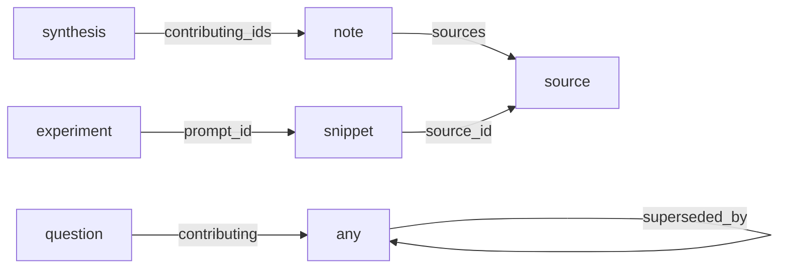

# Reference

The README explains what research-vault is. This page is for looking things up. It is a command overview with the flags you'll actually reach for. Running `research-vault` with no arguments prints the command list.

## Scope

research-vault is for *external* facts: documentation, API behaviour, tool-version claims and the decisions you made because of them. It is not a code indexer beyond the comments that cite the vault, and does not replace the agent's view of your repo. Without Node, an agent can still read a vault by globbing and grepping the folders; the CLI is the checked path.

## Where the vault lives

Tooling and vault data are separate by default. The vault is discovered in order:

1. `--vault <path>` flag
2. a repo's `.research-vault.json` (project binding, below)
3. `$RESEARCH_VAULT_PATH`
4. the config pointer `init` writes when it sets the default vault (first `init`, or `--set-default`)
5. the OS default: `$XDG_DATA_HOME/research-vault` (else `~/.local/share/research-vault`) on Linux, `~/Library/Application Support/research-vault` on macOS, `%LOCALAPPDATA%\research-vault` on Windows

## Skills and slash commands (Claude Code)

Each skill's description says when it applies.

| Skill | Job |
|---|---|
| `research-vault-usage` | Searching, citing with a freshness check, planning the entries a synthesis needs |
| `research-capture` | Writing a new entry by hand, with the dedup and supersede-not-rename steps |
| `research-verify` | Walking through re-checking a stale entry |
| `research-librarian` | Read-only curation guidance |
| `research-orchestrate` (`/research`) | A fresh research task end to end: vault first, then the web, every finding filed as entries |
| `research-authoring` | Use when a citation is about to land in prose you're writing in a vault-bound repo |
| `research-review` | Auditing an existing document or corpus against the vault |
| `research-teach` | Teaching a topic over sessions: resources and facts in the vault, evidence probed or read from stored sources, lessons in one of four shapes (`concept`, `tool`, `diagnose`, `project`), plus review lessons and checked tasks (a project lesson graded by `check.sh`, with `setup.sh` and `solution.sh` beside it, validated fresh-fails and solved-passes), checked by `teach lint`, read by a fresh `lesson-reader` agent, then gated by a fresh `claims-reviewer` agent, quiz attempts recorded by a local quiz server (`teach serve`) |
| `research-claims-gate` | Gating a draft that cites the vault: derives the evidence list, dispatches one fresh `research-vault:claims-reviewer`, records the verdict in the claims ledger |

Slash commands, all under `/research-vault:`: `research-init`, `research-search`, `research-related`, `research-lint`, `research-compile`, `research-obsidian`, `research`. Every skill is also `/research-vault:<name>` (for example `/research-vault:research-capture`).

## Binding a repo to a vault

<!-- evidence: 2026-11-11-claims-gate-cuts-md-draft-into 2026-11-11-claims-gate-git-worktree-binding-ledger 2026-11-11-claims-gate-markdown-units-md-draft 2026-11-11-clean-up-probe-one-binding-check 2026-11-11-corrected-lab-block-code-doc-quotes 2026-11-11-gate-ledger-hook-embedding-gate-runs 2026-11-11-issue-60-decisions-user-confirmed-0 2026-11-11-research-vault-issue-60-hooks-carry 2026-11-11-task-6b-claims-gate-skill-runs 2026-11-11-task-6b-final-staged-code-img 2026-11-11-task-6b-image-gate-runs-workspace 2026-11-11-task-6b-reviewer-lines-behind-claims 2026-11-12-claims-gate-item-2-evidence-filter 2026-11-12-lines-behind-claims-gate-item-2 2026-11-12-lines-behind-claims-gate-scope-plan 2026-11-12-reviewed-lines-spec-49-commit-1 2026-11-12-reviewed-spec-49-commit-1-lab -->

Run `init --project` at the root of a repo to write `.research-vault.json` there, and commit it. From then on:

- **Discovery.** A CLI command run from inside the repo resolves to that vault with no flag or env var (the binding is found by walking up from the working directory). For discovery the binding selects the vault; what an agent does with it comes from the vault's `AGENTS.md`.
- **`research-authoring`.** When a citation is about to land in prose you're writing in the repo, the skill tells the agent to search the vault first, check a found entry's freshness, capture what the vault is missing, and run `check` on the file after writing.
- **`check`.** Audits the repo's docs against the vault; each citation is `ok`, `stale` or `uncovered`. `check --check` exits non-zero so CI can fail on stale or uncovered citations.
- **Gate.** Lessons, reference docs and the `README.md` of every teach workspace (a directory holding `MISSION.md`) found under the repo are gated, plus any file matching the optional `gates.globs` array in `.research-vault.json`, for example `"gates": { "globs": ["docs/**/*.md"] }`. The `research-claims-gate` skill records each `PASS` or `MERIT` verdict with `gate record` in `.research-vault-ledger.jsonl` at the repo root, keyed to the file's content hash and to a hash per unit, so an edit that changes a unit needs a new verdict for that unit, while an edit that leaves every unit's hash unchanged keeps the earlier verdict (`(by unit)`). The row also carries `reviewer`, the sha256 of the plugin's `agents/claims-reviewer.md`, and counts only while that hash is absent (no reviewer hash was recorded) or equal to the installed reviewer's; after a change to the agent file, `gate status` prints `none (reviewer changed)` for a file whose passing rows all came from the earlier one. A lesson's units are its `data-block` elements (the fact block per paragraph, the quiz per item) and one `img:<src>` per ``, hashed over its `<figure>` and the image file's bytes (a change to the file alone reopens only that unit, and a caption or alt change also reopens the data-block holding the figure, or for a `fact` block the paragraph holding it (a figure between `fact` paragraphs reopens only its own unit); a changed image file leaves its page without a verdict in `gate status`, a staged image file puts its page in front of `gate staged` and a changed one in front of the Stop hook, in both cases only while the file still exists, so neither sees a deleted one); a Markdown file's (a path ending in `.md`, cut this way whatever HTML it quotes, `data-block` attributes included) are its ATX (`#`) heading sections (`sec:<slug>`, `sec:preamble` before the first heading) and each table row of one (`sec:<slug>/<first-cell slug>`, so a one-row edit reopens only that row), and `gate evidence --changed` prints `unit sec:<slug> <file>:<start>-<end> prose` for each changed one so the reviewer reads only those, and lists only the citations inside those units, plus `--extra` (a changed row with none takes those of its section's lines outside rows; a changed unit with none, or no changed unit, gives the whole file's); a file with neither is one unit, `all`. The Stop hook blocks a turn that leaves a changed gated file without a `PASS` or `MERIT` verdict for its current content (a row for those exact bytes while no image it references has changed, or every unit covered by some row). After an edit to a gated file or one matching `references.globs`, a hook reports its uncovered or stale citations without blocking; an edit inside the vault runs `lint --fix` instead, so this applies to files outside the vault. `gate status <file> --check` exits 1 when the current content has no passing verdict; `gate staged --check` does the same over every gated file staged in git, one line per file, for a pre-commit hook (the plugin repo ships one in `.githooks/`). A vault entry outside any bound repo can be gated too; its ledger lives in the vault.
- **Embedding endpoint.** `"embedding": { "url", "model"?, "chunk"?, "overlap"? }` (defaults 800 and 100) turns on `embed`, which writes the disposable index `_index/embeddings.jsonl` from every non-superseded entry's windows, and `search --semantic`; both need `RESEARCH_VAULT_ALLOW_NETWORK=1` and `--ack-data-egress`, since the text goes to that URL. Without the block, both refuse (`no embedding endpoint in .research-vault.json`) and no index is written.
- **Lab.** An optional `"lab": { "docs", "uses", "bypass" }` block, each a non-empty array of non-empty strings, for example `"lab": { "docs": ["LAB.txt"], "uses": ["lab/lib.sh"], "bypass": ["kind create cluster"] }`. `docs` lists the files that explain the repo's lab, relative to the directory holding `.research-vault.json` (an absolute path or a `..` segment is rejected); `uses` and `bypass` are literal strings, not patterns. With the block, `teach lint` reads every `.sh` file under the workspace's `labs/`, `evidence/` and `lessons/` and reports the advisory `WARN_LAB_BYPASSED` for a file that holds a `bypass` string on a non-comment line, quoted strings read as empty, and no `uses` string outside a comment or an `echo` line, unless the file is under `evidence/NNNN/` or `lessons/files/NNNN-` and `evidence/NNNN/PLAN.md` has a line starting `own environment: <reason>`; a script under `labs/` is never silenced (LESSON-FORMAT.md has the rule). Plugin version 0.11.0 is the first that reads the block; 0.9.0 (the older version run) drops it silently, as it drops a misspelled key. A malformed block throws `invalid .research-vault.json: lab ...` (`lab must be an object`, or `lab.<field> ...`): a CLI command that resolves its vault from the binding exits 2, while the hooks catch the error and carry on.
- **Usage log.** `_index/usage.jsonl` in the vault, one JSON object per line: a `queried` event from the pre-web hook (the tool, the outcome `url-hit`, `hits` or `no-match`, the ids surfaced) and from `search` (the `--type` and `--topic` facets, the outcome, the ids returned), and a `cited` event per id a watched file newly cites, from the post-edit hook (the file's repo-relative path and the id; the log itself is the record of what was already logged). Ids, facets and the outcome are always written; free text (the pre-web terms, the `--text` value) only when the binding sets `"usage": { "text": true }`. The template's `.gitignore` already ignores `_index/`; if a vault's `.gitignore` lacks the line, add it. `advise` reads the log for its usage section and skips a line that is not JSON.

### Code links

A vault id on a comment line of its own, above a column-0 declaration, cites that entry for the symbol below it. The id may carry a pin, `<id>@<key>=<version>`, naming a key of `code.versions` and the version the code was checked against:

```lua
-- Sleep-mode call order per 2026-03-03-sleep-mode-api@sdk=0.20
function ns.Sleep(frame)
```

Blank and comment lines may sit between the comment and the declaration; several ids on one line, or several comment lines above one declaration, are several links to the same symbol. A link whose next non-blank, non-comment line is not a column-0 declaration is `unattached`: reported, never dropped.

**Opt-in.** `init --project --vault <relative dir> --code-links '<glob>[,<glob>]'` writes the standard binding plus a `code` block, and a `code` block written by hand into an existing binding is the same opt-in. The block is accepted only on a relative `vault` inside the repo: an absolute, empty, `..` or absent vault is rejected with `code links need a project-specific vault inside the repo (a relative vault path); this binding points at <vault>` (`(none)` when the vault is empty or absent). Without the block, `check`, the gate and the hooks take today's code path and the comments are ordinary comments.

```json
"code": {
  "globs": ["src/**/*.lua"],
  "languages": {},
  "versions": {
    "sdk": { "file": "package-lock.json", "pattern": "\"node_modules/sdk\": \\{\\s*\"version\": \"([^\"]+)\"" }
  }
}
```

- **`versions`.** Each key names a `{ file, pattern }`. The pattern is a JavaScript regex applied with the `m` flag to the whole file; the first capture group of the first match is the declared version. A file that is missing or that the pattern does not match is a configuration error (`check` exits 2 with `versions.<key>: cannot read <file>` or `versions.<key>: pattern matched nothing in <file>`), not a row per link. `package-lock.json` nests the installed version under `packages[<path>].version`. One-line forms: the `## Interface:` line of an addon `.toc`; a `go.mod` `require` line, which declares a minimum version while the selected version may be higher; a `.minimum_zig_version` line in `build.zig.zon`. `check` prints the values it read as a footer, `versions: sdk=0.20`.
- **`languages`.** A language is `{ comment, decl }`, two regex sources: `comment` matches one whole comment line and captures its text in group 1; `decl` matches one column-0 declaration line and captures the symbol name in its first non-empty group. Each must compile and hold a capture group, else the error names the field (`code.languages[".py"].decl: pattern has no capture group`). The plugin ships rows for `.lua`, the JavaScript and TypeScript family (`.js`, `.mjs`, `.cjs`, `.jsx`, `.ts`, `.mts`, `.cts`, `.tsx`), `.py`, `.go`, `.rs`, `.zig`, `.rb`, `.sh`/`.bash` and C/C++ (`.c`, `.h`, `.cpp`, `.hpp`, `.cc`, `.hh`); each sees only column-0 declarations, so a method inside a class body, or a decorator or attribute line between the comment and its declaration, is not seen. The Lua row:

  ```js
  comment: /^\s*--(?!\[=*\[)(.*)$/,
  decl: /^(?:local\s+)?function\s+([A-Za-z_][\w.:]*)\s*\(|^(?:local\s+)?([A-Za-z_][\w.]*)\s*=(?!=)/,
  ```

  A project adds any other language as a row keyed by extension in `code.languages`, and may override a shipped row; a `code.globs` file whose extension has a row from neither is a configuration error, `no language for .kt in code.globs; add code.languages[".kt"] = { comment, decl }`. `comment` is matched line by line, so a block-only comment syntax needs a line prefix inside the block.
- **Statuses.** A code row is `ok`, `uncovered` (no entry for the id), `unattached`, or `stale` with its reason: `(time)` for an unpinned link whose entry is past its volatility window, or a pinned link to a `volatile` entry; `(superseded by <id>)` for an entry with `status: superseded`; `(<key> <pinned> -> <declared>)` for a pin that differs from the declared version; `(no key <key> in code.versions)`. A pin selects the version rule over the time rule; an unpinned link follows the entry's window as prose does. `check --check` exits 1 on any `stale`, `uncovered` or `unattached` row.
- **Gate.** Each linked declaration is a unit, `sym:<name>`, hashed from its leading comment block to the line before the next column-0 declaration's comment block, with pin values stripped, so moving the block, editing a neighbour or moving a pin reopens nothing and editing the body does. Code files with an attached link are gated like `gates.globs` files; `gate evidence <file> --changed` adds one line per changed unit, `unit sym:<name> <file>:<start>-<end> <status>`, which the `claims-reviewer` reads as its line range. The post-edit hook reports a code file's non-`ok` rows and, after an edit to a `versions` file, every link whose pin differs from the version now declared. The Stop hook also blocks a turn in which a `versions` file changed and a link is still pinned to another value, naming the link and the two versions.

## Extending the controlled vocabulary

The schema enums are small on purpose. A vault that needs its own terms (a lab recording `lab-run` as a verification method, a team with an extra `domain`) adds them in `.research-vault.json`:

```json
{
  "vault": "research",
  "taxonomy_extensions": {
    "verification_method": ["experiment", "lab-run"],
    "verification_result": ["partial"],
    "topic_aliases": { "k8s": "kubernetes" }
  }
}
```

- **Additive only.** You can add values, never remove or redefine a built-in, so entries stay portable between vaults.
- **Extensible fields:** `domain`, `confidence`, `outcome`, `question_state`, `verification_method`, `verification_result`. `volatility` and `stage_by_folder` are not extensible, and `topics:` already accepts any tag.
- **`topic_aliases`** is a map of vault pairs, alias to canonical topic, merged after the built-in pairs; a pair whose key is a built-in alias is refused. `capture`, `lint`, `advise`, `search` and `teach path candidates` all read the merged map, and `lint --fix --topics` rewrites existing entries.
- **Keyed on the vault**, not your shell's working directory, so the vocabulary is the same wherever a command runs.

To change the built-in vocabulary itself, edit `schema/taxonomy.json`. The linter, `capture`, the generated `AGENTS.md` and each vault's copied `taxonomy.json` all derive from it.

## Freshness

Each entry has a `volatility` tier with a review interval. An entry is stale when its last confirming verification is older than the interval.

| tier | covers | interval |
|---|---|---|
| `stable` | fundamentals, algorithms, classics | 3 years |
| `slow` | established practices, mature frameworks | 1 year |
| `fast` | specific tool APIs, framework versions, LLM capabilities | 90 days |
| `volatile` | pricing, rate limits, current best model, availability | always re-check |

A note or synthesis is only as fresh as its evidence; `advise` reports conclusions whose source chain reaches a stale or replaced entry.

## Versions and replacements

These are different things:

- **A new version of a tool is new knowledge, not a correction.** `vcluster 0.19` and `0.20` are two active entries sharing a `series`. Record this with `verify --succession` on the older entry, then capture the newer version as its own source with `--subject-name`, `--subject-version` and `--series`.
- **A replacement is for an entry that is wrong or obsolete.** Capture the corrected entry first, then `verify --id OLD --method <method> --result outdated --superseded-by NEW`. The old entry stays on disk with `status: superseded`; `search` hides it unless `--include-superseded`, and `related` still shows it so the evidence trail stays visible.

## Entry types and the graph

| Folder | Holds | Create one when |
|---|---|---|
| `sources/` | Raw captures of external material, as-is | you clip something worth keeping |
| `notes/` | Your distilled take on one or more sources: the load-bearing claims and how you'd use them | you read a source and want a durable, skimmable version |
| `synthesis/` | Conclusions drawn across several entries | you see a pattern worth stating once |
| `snippets/` | Reusable code or prompt fragments | you have a fragment you'll reuse |
| `experiments/` | Logged trial runs with task, parameters and outcome | you run a trial worth recording |
| `questions/` | Open questions (`open → investigating → answered`) | you hit something to track and answer over time |

Distillation (source → note → synthesis) is a deliberate step; nothing auto-promotes. A synthesis usually cites notes, and may also cite sources, experiments, questions and snippets directly; a factual rollup (a release-note matrix, a version diff) may skip notes if it declares `synthesis_basis: primary-rollup`.

Stored references point from the declaring entry to what it references:



`.vault-manifest.json` lists every reference as a typed edge and inverts the backlink-forming ones. Each vault's generated `AGENTS.md` §5 documents the fields and §5.2, Asking the graph.

### Reading the graph from outside

A project that keeps its own graph (a code dependency map, a Neo4j load, a Graphviz script) does not need the plugin's view of it. Two outputs carry everything, both plain JSON, neither stored in git, so run the command first:

- **The vault graph**: `lint` writes `<vault>/.vault-manifest.json` with `generated`, `entries`, `edges` and `backlinks`. An entry row has `id`, `type`, `title`, `summary`, `domain`, `topics`, `source_url`, `content_hash`, `volatility`, `last_verified`, `status`, `subject`, `series`, `stage`, `state`, `confidence`, `outcome`, `authority_tier`, `authority_basis`, `superseded_by`, `related`, `contributing_ids` and `sources`; an absent field is `null` or `[]`, never missing (`status` defaults to `active`). An edge is `{ from, rel, to }` with `rel` one of the reference fields above, sorted by `from`, `rel`, `to`. `backlinks` maps an id to the sorted ids that reference it through a backlink-forming field. Bodies are not included: the id is the filename under the type's folder.
- **The code edges**: `check --json` from the repo root prints `generated`, `summary`, `rows`, `skipped` and, with a `code` block, `versions`. A code row has `file`, `type`, `value`, `symbol`, `line`, `key`, `version`, `status` and, when covered, `id` and `volatility`, plus `reason` when stale; a prose row has `file`, `type`, `value`, `status` and, when covered, `id` and `volatility`. Join a row's `id` to an entry's `id` and the code side of the graph is complete.

These keys are the integration contract: `test/contract.test.mjs` pins them, and a change is a breaking one in the CHANGELOG. `examples/graph-dot.mjs` is the join written out as Graphviz DOT, and `examples/blast-radius.mjs` is the other direction: given the manifest, one entry id and one or more `check --json` outputs, it walks the `sources` and `contributing_ids` edges inward and prints the entries that rest on the id and every row that cites one of them, which is what to re-check when the entry is superseded; [ADOPTING.md](ADOPTING.md) is the ordered walkthrough for a new project.

Two facet tiers keep retrieval clean as a vault grows: **`domain`** is a small controlled set of broad areas (`software-engineering`, `systems-infrastructure`, `data-ml`, `security`, `learning`, `llm-assisted-dev`, `meta`, `natural-science`, `humanities`, `business-finance`, `health-fitness`, `language-learning`, `arts-crafts`); **`topics`** is freeform and is where specific tech lives.

## Commands

Run as `node bin/research-vault.mjs <command>` from a clone, or `research-vault <command>` if you've put it on your PATH. Every command takes `--vault <path>`. For example:

```text
research-vault capture --type source --title "vcluster sleep mode" \
  --url https://example.org/sleep-mode --domain systems-infrastructure \
  --topics kubernetes,vcluster --subject-name vcluster --subject-version 0.20
research-vault search --topic vcluster
research-vault verify --id <id> --method refetched-source --result confirmed
```

Ids are `<date>-<slug>`; use the one `capture` or `search` prints rather than guessing it.

| Command | Does |
|---|---|
| `init` | Scaffold a vault and generate its `AGENTS.md`. `--project` binds the current repo; with `--code-links '<glob>[,<glob>]'` it also writes the `code` block, which needs a relative `--vault` inside the repo. `--refresh-docs` regenerates `AGENTS.md` and `taxonomy.json` in an existing vault and touches nothing else (entries and `meta/` are preserved). |
| `capture` | Add an entry. Required: `--type`, `--title`; sources also `--url`. Common: `--domain`, `--topics a,b`, `--subject-name`/`--subject-version`/`--series`, `--summary`, `--sources` (notes), `--contributing-ids` (syntheses), `--confidence`. Dedupes by URL and version. `--scaffold` writes a per-type body skeleton; `--body-file` supplies prose for non-source types; `--content-file` and `--captured-via` record local provenance; `--store-body` keeps the text you pass with `--content` or `--content-file` in a source entry and needs `--ack-data-egress`; a single capture never fetches the URL itself. `--batch <path>` takes a JSON plan (an array of specs), a URL list (one per line, `#` comments; needs `RESEARCH_VAULT_ALLOW_NETWORK=1` and fetches each through the `refresh` fetcher) or a directory of Markdown files (`source_url` or `url`, `title` and `author` from frontmatter, else the first link and the first heading); it validates every entry before writing any, reports duplicates as skipped and failures with a reason per item, writes nothing on a validation failure unless `--continue`, which writes the rest (a filesystem failure can leave partial output either way), and `--store-body --ack-data-egress` keeps the fetched or read text. A source whose URL matches `meta/source-blocklist.json` in the vault (rows `{ pattern, scope: url | domain, reason, added }`; a `domain` row covers its subdomains, a `url` row is a prefix after normalisation) is refused with the reason; `--force` captures it and records the override in the `captured` verification's notes; in `--batch` a match is the item's error. |
| `lint` | Validate the vault and rebuild the manifest. `--check` for CI (exits non-zero on violations or a stale manifest); `--fix` applies safe normalizations; `--fix --topics` also rewrites each aliased topic to its canonical value (built-in and vault pairs) and deduplicates the list. A source matching `meta/source-blocklist.json` warns `WARN_SOURCE_BLOCKED`; a list that does not parse is the violation `BLOCKLIST_INVALID`. |
| `verify` | `--stale` lists entries past their interval. `--id <id> --method <m> --result <r> [--notes]` records a check. `--result outdated --superseded-by <id>` replaces; `--succession` records the check and keeps the entry active for its version, printing the `capture` line for the newer version's sibling entry. `--id <question> --answered-by <id> [--answer-summary <text>]` closes a question: `state: answered`, the summary (the answering entry's `summary` when the flag is omitted) and the id appended to `contributing`, with no verification row. |
| `search` | `--type`, `--domain`, `--topic`, `--series`, `--text` (title, topics, summary), `--body`, `--json`. Superseded entries are hidden unless `--include-superseded`. `--sort authority` orders by the taxonomy's tier array with untiered rows last; `--sort fresh` orders fresh, then stale, then not assessable; ties keep manifest order, the default. Each text line ends with `(<tier or no tier>, fresh|stale)`, followed by `(superseded by <id>)` on a superseded row shown with `--include-superseded`; the freshness part is absent when freshness cannot be assessed (`staleness()` returns null). `--semantic <text>` ranks the facet-filtered, non-superseded rows by the best cosine between the query's embedding and their indexed windows, a stale row's score multiplied by 0.8, cut to `--limit` (default 10); each line ends with `score <n.nn> #<window>`, `--json` adds `score` and `chunk`; it refuses without the binding's `embedding` block, the network variable, `--ack-data-egress` or an index (`run embed first`), and cannot be combined with `--sort`, `--text` or `--body`. |
| `related` | Typed links for an entry. `--depth N`, `--direction` (`out`, `in` or `both`), `--rel a,b`, `--format mermaid`. |
| `advise` | Read-only report: stale entries, stale evidence chains, orphans, sources without notes, unverified sources, missing summaries, aliasable topics, stub bodies, quote residue, open questions past 60 days, supersede suspects (two live entries of one type at one subject version with one `source_url` or one subject name), near duplicates (two live sources at different normalised URLs, either on one host sharing more than half of the longer path's segments, or whose titles share at least two terms, more than half of the longer title's terms), usage (per entry the surfaced and cited counts, per queried topic the query and no-match counts, and the live sources never cited, split by whether one of their topics was queried; read from the usage log). `--json`. |
| `manifest` | Rebuild (`--rebuild`) or print the derived index. `--topics` (no value) lists the topic vocabulary in place of the JSON, one `<topic> <count>` line per topic on a non-superseded entry, sorted by topic; with `--rebuild` it follows the rebuild's count line. `--rebuild` reports each edge to a missing entry on stderr before writing, and refuses to write when an entry the current manifest lists would be dropped while its type folder is missing or its file is still there (`manifest not written: ...`; delete `.vault-manifest.json` to accept the shrink). |
| `compile` | Regenerate the human-readable `_index/` (git-ignored, derived). |
| `obsidian` | Regenerate `_obsidian/` (git-ignored, derived). Open that folder, not the vault root, as an Obsidian vault; stubs carry `type/`, `status/`, `domain/`, `volatility/`, `freshness/` and `topic/` tags, so a graph filter like `tag:#freshness/stale` colours what matters. In a repo bound with a `code` block, `_obsidian/code/` holds one note per linked code file (tag `type/code`) with a wikilink per code link, so the graph shows which code cites which entry. The first run seeds `_obsidian/.obsidian/graph.json` (MOC hidden, colours by type, stale red); edit it in Obsidian as you like, later runs keep it. |
| `check` | Audit a document or glob outside the vault. `--report` or `--json` emit a coverage matrix; `--check` exits non-zero on a stale or uncovered citation. URLs and ids inside code spans and fenced blocks are not citations; a value found only in code is reported as skipped. A fence left unclosed makes the rest of the file code, and `check` lists a URL found only there as skipped. With a `code` block in the binding, files matching `code.globs` are read for code links instead (one row per link, printed as `file:line symbol`), the summary gains the `unattached` and code-link counts, and a `versions:` footer lists the declared versions; with no positional glob, `references.globs` and `code.globs` are both checked. Read-only, no network. |
| `gate` | `gate evidence\|changed\|record\|status\|staged`: derive a draft's evidence list from the vault, with one `image: <workspace-relative path> sha256:<hash>` line per readable png, jpg, jpeg, gif, svg or webp file a lesson or reference page references (`evidence <draft> [--extra <ids>] [--changed] [--json]`; with `--changed`, a Markdown draft with headings gets the changed units' citations by the Gate rule of [Binding a repo to a vault](#binding-a-repo-to-a-vault), plus `--extra`), list the units no `PASS` or `MERIT` row covers (`changed <draft>`, exit 1 when there are any), record a claims verdict keyed to the file's content hash (`record <file> <PASS\|FAIL-as-sent\|MERIT> [note]`), report the verdict for the current content (`status <file> [--check]`, exit 1 with `--check` when there is no `PASS` or `MERIT`), or report every gated file staged in git with its verdict (`staged [--check]`, exit 1 with `--check` while any has none; for a pre-commit hook). <!-- evidence: 2026-11-11-claims-gate-cuts-md-draft-into 2026-11-11-claims-gate-git-worktree-binding-ledger 2026-11-11-claims-gate-markdown-units-md-draft 2026-11-11-clean-up-probe-one-binding-check 2026-11-11-corrected-lab-block-code-doc-quotes 2026-11-11-gate-ledger-hook-embedding-gate-runs 2026-11-11-issue-60-decisions-user-confirmed-0 2026-11-11-research-vault-issue-60-hooks-carry 2026-11-11-task-6b-claims-gate-skill-runs 2026-11-11-task-6b-final-staged-code-img 2026-11-11-task-6b-image-gate-runs-workspace 2026-11-11-task-6b-reviewer-lines-behind-claims 2026-11-12-claims-gate-item-2-evidence-filter 2026-11-12-lines-behind-claims-gate-item-2 2026-11-12-lines-behind-claims-gate-scope-plan --> |
| `teach` | Teaching workspace verbs: `record add`, `record supersede`, `attempt add`, `attempt import`, `cast check`, `cast transcript`, `export`, `lint`, `next`, `path candidates`, `path edges`, `progress`, `readme` and `serve`, each under its own heading in [teach](#teach) below. |
| `refresh` | Re-fetch sources to see whether they changed; reports `confirmed`, `changed` or `unreachable` per source and never edits entries. Run `verify` on anything `changed`. `--json` prints one object per result, `{ id, result, detail?, storedBody? }`; `storedBody`, on a `changed` result, says whether the entry's body holds a line other than blanks, a lone `-`, lines starting with `#` or a bare ``` line (stored prose is such a line) to diff against. Needs `RESEARCH_VAULT_ALLOW_NETWORK=1`. |
| `embed` | Build `_index/embeddings.jsonl` for `search --semantic`: every non-superseded entry's windows (the binding's `chunk` and `overlap`) embedded through the binding's `embedding.url` in batches of 64; needs `RESEARCH_VAULT_ALLOW_NETWORK=1` and `--ack-data-egress`; refuses without the block. |
| `export` | JSONL for fine-tuning or eval, to stdout or `--out <path>` (outside the vault). Default: answered-question pairs. `--scope <types>` chooses which types to export instead (include `question` to keep the pairs); other types emit title and summary, and bodies need `--include-bodies --ack-data-egress`. Every record's `meta` carries `id`, `type`, `last_verified`, `topics`, `authority_tier`, `volatility` and `source_url`. `--chunk <chars> [--overlap <chars>]` emits one record per window of the output, counted in UTF-16 code units (the JavaScript string length, so a window can split a surrogate pair), with `meta.chunk` `{ index, start, end, total }` (reassemble by appending each later window from offset `overlap`); `--fresh-only` drops superseded and stale entries; `--min-authority <tier>` drops sources below the tier and keeps untiered rows. See [FINETUNING.md](FINETUNING.md). |

Four operations require a command rather than prose, by design: `lint` (correctness is checked, not asserted), `init`, `refresh` (network opt-in) and `export` (leaves the vault).

## teach

<!-- evidence: 2026-11-03-lines-behind-research-teach-skill-claims 2026-11-03-path-verbs-probe-candidates-pool-edges 2026-11-03-path-verbs-probe-runner-at-e9a1559 2026-11-03-second-lines-behind-issue-3-teach 2026-11-03-teach-row-probe-lint-exit-codes 2026-11-11-lines-behind-spec-48-teach-export 2026-11-11-research-vault-issue-66-readme-code 2026-11-11-spec-48-commit-1-review-round 2026-11-11-spec-48-commit-2-review-round 2026-11-12-third-lines-snippet-behind-spec-49 -->

The `teach` verbs, one heading each. The workspace is the positional path, which must hold `MISSION.md`, else the cwd when it holds `MISSION.md`; otherwise usage and exit 2.

### teach record add

<!-- evidence: 2026-11-03-lines-behind-research-teach-skill-claims 2026-11-03-teach-verbs-fixture-workspace-at-b4b01f7 2026-11-11-clean-up-probe-two-teach-path -->

`teach record add --title <t> --kind <k> [--lesson <id>] [--body-file <path>] [workspace]`.

### teach record supersede

<!-- evidence: 2026-11-11-clean-up-probe-two-teach-path -->

`teach record supersede <id> --by <id> [--reason <text>] [workspace]`.

### teach attempt add

<!-- evidence: 2026-11-03-lines-behind-research-teach-skill-claims 2026-11-03-teach-verbs-fixture-workspace-at-b4b01f7 2026-11-11-clean-up-fix-round-one-probe 2026-11-11-clean-up-probe-two-teach-path 2026-11-11-lines-behind-spec-48-teach-export 2026-11-11-spec-48-commit-1-review-round 2026-11-12-third-lines-snippet-behind-spec-49 -->

`teach attempt add --lesson <id> --answers <comma list> [workspace]`, `teach attempt add --lesson <id> --result pass|fail [workspace]` (a project run).

### teach attempt import

<!-- evidence: 2026-11-11-spec-48-commit-1-review-round 2026-11-11-teach-attempt-import-review-round-runs 2026-11-11-teach-export-review-round-runs-spec -->

`teach attempt import <file> [workspace]` (reads a results file, the JSON that quiz.js's `resultsFile` builds: `"format": "research-vault-attempts"`, `"version": 1`, `workspace`, which must be the workspace directory's name passed through `slugify`, and `attempts`, each `{ lesson, answers, at, total, wrong }`; exit 2 with no file argument, no workspace, a file it cannot read (`teach attempt import: cannot read <file> (<code>)`) or one over 1 MiB (`teach attempt import: <file> is over 1 MiB`); it prints a `file: <reason>` or `attempt <n>: <reason>` line for each problem (`n` counts from 1; an attempt whose keys are wrong gets that line alone), writes nothing and exits 1 for a file that is not JSON, top-level keys other than those four, another `format`, `version` or `workspace`, `attempts` empty or not an array, an attempt whose keys are not those five, a lesson that is not a lesson id or has no `lessons/<id>.html`, `answers` that is not an array of non-negative integers, or an `at` not in `toISOString` form or later than this machine's clock, and every value from the file that such a line names is printed through `JSON.stringify`, with U+007F to U+009F, U+200E, U+200F, U+202A to U+202E, U+2028, U+2029 and U+2066 to U+2069 also written as `\uXXXX`, and an array or object value as `an array` or `an object`; otherwise it prints one line per attempt in file order: `skipped <id>: already recorded` when `attempts/<id>.md` exists or an earlier attempt in the file is recorded under it, `<id>` being the attempt id its lesson and `at` give; `changed <lesson>: browser <score>/<total>, now <score>/<total>` when the lesson has no quiz that parses (printed `now -/0`), its answers no longer fit the lesson (another item count or an index out of range, printed `now -/<total>`) or their grade differs from the file's `total` and `wrong`, and that attempt is not written; else `recorded <id>: <score>/<total>`, the attempt written by `writeAttempt`, as `POST /attempt` writes it, with `at` as the clock; exit 1 when any line is `changed`, else 0).

### teach cast check

<!-- evidence: 2026-11-12-brand-lint-export-serve-cast-evidence 2026-11-12-issue-65-replay-prototype-runs 2026-11-12-lines-behind-issue-65-replay-prototype 2026-11-12-lines-behind-task-14-follow-ups -->

`teach cast check <file> [--needle <value>]...` (scans an asciicast v2 or v3 file: its `o` and `i` events joined in order with CSI and OSC escape sequences removed, and each string value of its header, for each `--needle` value and each token shape of `TOKEN_SHAPES` in `bin/lib/cast.mjs` (LESSON-FORMAT.md, Replays, lists them); exit 0 with `cast: clean`; exit 1 with one line per kind found in the events and one per kind found in the header, `secret <file>: <kind> at event <n>` (`n` counts the events from 0, the one where the match starts) or `at the header`, the kind of the nth `--needle` being `needle <n>`, so a line never holds the value; exit 2 with usage when a `--needle` has no value, or with `teach cast: <file>: not an asciicast v2 or v3 file` or `cannot read (<code>)`).

### teach cast transcript

<!-- evidence: 2026-11-12-brand-lint-export-serve-cast-evidence 2026-11-12-issue-65-replay-prototype-runs 2026-11-12-lines-behind-issue-65-replay-prototype 2026-11-12-lines-behind-task-14-follow-ups 2026-11-12-task-14-follow-up-runs-after 2026-11-12-teach-row-probes-cast-transcript-wrapped -->

`teach cast transcript <file>` (prints the cast's `o` events as text for a replay's `<pre>`: CSI, OSC and charset escape sequences removed, CRLF a line break, other C0 control characters but tab and line feed, and DEL, dropped, `&`, `<`, `>` and `"` escaped).

### teach export

<!-- evidence: 2026-11-11-lines-behind-spec-48-teach-export 2026-11-11-second-lines-behind-spec-48-teach 2026-11-11-spec-48-commit-2-review-round 2026-11-11-teach-export-review-round-runs-spec 2026-11-11-third-round-spec-48-export-probes 2026-11-12-brand-lint-export-serve-cast-evidence 2026-11-12-issue-65-replay-prototype-runs 2026-11-12-lines-behind-issue-65-replay-prototype 2026-11-12-lines-behind-spec-50-commit-1 2026-11-12-lines-behind-spec-51-build-at 2026-11-12-lines-behind-task-14-follow-ups 2026-11-12-reviewed-lines-spec-49-commit-1 2026-11-12-reviewed-lines-spec-49-commit-2 2026-11-12-reviewed-spec-49-commit-1-lab 2026-11-12-spec-50-commit-1-brand-runs 2026-11-12-spec-51-divider-build-runs-at 2026-11-12-task-14-follow-up-runs-after 2026-11-12-teach-row-probes-cast-transcript-wrapped 2026-11-12-third-lines-snippet-behind-spec-49 -->

`teach export [workspace] --out <dir> [--skip-ungated] [--vault <path>]` (writes a copy of the workspace to open from `file://` with no server, opened so far in headless Chrome 157 only: `index.html`, `progress.html`, `sources.html`, `GLOSSARY.md` unless it is a symlink (which `teach serve` does not serve either), every file `teach serve` returns under `lessons/`, `reference/`, `assets/` and `brand/` except an `.html` or `.htm` file other than `lessons/*.html` and `reference/*.html`, which it leaves out and prints as `not gated <path>`, the workspace's `assets/lesson.css` (its name in any case) or else the plugin's, and the plugin's `reading.html` and `quiz.js`, with each line-initial `export ` removed, in place of the workspace's copies (their names in any case, such as `assets/Quiz.js`); each page carries the workspace's brand as `teach serve` adds it, divider pages included, written as `dividers/<k>.html` (with `--skip-ungated`, a footer's `lesson N of M` counts the exported lessons); in each page the tag that loads `quiz.js` becomes `<script defer src="...">`, a lesson gets its navigation bar (All lessons, Progress, How to read, previous, `line N of M`, next) written into the file, `<body>` gets `data-export="<key>"`, `<key>` being the workspace directory's name passed through `slugify`, and a lesson's `<body>` gets `data-lesson` from its file name when it has none, a root-absolute `href` or `src`, in double or single quotes, becomes relative (`/` to `index.html`, `/progress` to `progress.html`), a sources-block anchor with no `href` links to its entry on `sources.html`, `You can ask follow-up questions in the terminal.` becomes `You can ask your instructor follow-up questions.`, `Type your answer to Claude Code in the terminal, in a few sentences:` becomes `Write your answer down, or send it to your instructor, in a few sentences:`, each also when a line break or a run of spaces stands between two of its words, an element that has `data-cast` naming a cast under `assets/` that `teach serve` returns gains `data-cast-text` holding that file's text, escaped, and on `index.html` the body of the README's `## How to take it` section becomes `Open the lessons below in order. Your quiz answers are kept in this browser; use Export my results on the Progress page and send the file to your instructor.`; `progress.html` lists the attempts saved in that browser; exit 2 with usage when `--out` is missing, with `teach export: no vault at <path>`, or with `teach export: --out <dir> is a symlink`, `is inside the vault`, `is inside the workspace's lessons/` (likewise `reference/`, `assets/` and `brand/`) or `exists and is not an empty directory`; it checks every page before it writes, and writes nothing and exits 1 when a lesson, reference doc or the `README.md` has no `PASS` or `MERIT` for its current content (an `ungated <path>` line each, then `teach export: <n> page(s) have no PASS or MERIT for their current content; nothing written (--skip-ungated leaves them out)` on stderr), when a sentence of an exported page's text (its last sources block when that element closes, `<pre>` and `<code>` removed, the quiz JSON kept, `&nbsp;` and every run of whitespace, a line break included, read as one space) or of `GLOSSARY.md` (a single line break read as a space) matches `in the terminal`, `in your terminal`, `teach serve` or `Claude Code` in any case (`mention <path>: <sentence>`; `sources.html` is not checked), when a page cites an id with no vault entry (`unknown-source <path>: <id>`), or when two paths of the copy differ only by case (`case-collision <path>: <path>`), when a file of the copy holds the value, 8 or more characters long, of an `env` name of a valid `labs/labs.json` set in the environment (`secret <path>: <NAME>`), when `labs/labs.json` is invalid and an exported lesson has a lab section (`lab-manifest labs/labs.json: invalid; run teach lint`), or when a `brand/` folder's `brand.json` is missing or invalid (`brand brand/brand.json: invalid; run teach lint`); with `--skip-ungated` a page with no verdict is left out of the copy, the index and every navigation bar and printed as `skipped <path>`, a skipped README leaves the index with none, and a link to a skipped page in another page's prose stays; otherwise it prints `source <id> <url>` (`-` for none) for each cited entry, which `sources.html` lists in id order with its title, linked only to an `http:` or `https:` URL, the date its id begins with and its summary, then `wrote <n> files to <dir>`, and exits 0; a write that fails part way removes what the run created (`--out` itself when it was absent) and exits 2 with `teach export: cannot write under <dir> (<code>); removed what this run wrote`).

### teach lint

<!-- evidence: 2026-11-03-follow-up-probe-cp-n-progress 2026-11-03-lines-behind-checked-tasks-follow-ups 2026-11-03-lines-behind-research-teach-skill-claims 2026-11-03-second-lines-behind-checked-tasks-follow 2026-11-03-second-lines-behind-issue-3-teach 2026-11-03-teach-lint-checked-task-at-f2d403c 2026-11-03-teach-lint-warn-task-check-mutates 2026-11-03-teach-row-probe-lint-exit-codes 2026-11-03-teach-verbs-fixture-workspace-at-b4b01f7 2026-11-11-clean-up-fix-round-one-probe 2026-11-11-clean-up-probe-two-teach-path 2026-11-11-code-lines-behind-clean-up-narrowings 2026-11-11-corrected-lab-block-code-doc-quotes 2026-11-11-research-vault-issue-60-teach-lint 2026-11-11-research-vault-issue-66-readme-code 2026-11-11-research-vault-issue-66-tidy-round 2026-11-11-spec-48-commit-2-review-round 2026-11-11-task-2-issue-59-lesson-format 2026-11-11-task-6a-final-staged-code-parent 2026-11-11-task-6a-final-teach-lint-image 2026-11-11-task-6a-teach-lint-image-fill 2026-11-11-task-6a-teach-lint-image-text 2026-11-11-warn-lab-bypassed-scope-blind-spots 2026-11-12-brand-lint-export-serve-cast-evidence 2026-11-12-issue-65-replay-prototype-runs 2026-11-12-lines-behind-issue-65-replay-prototype 2026-11-12-lines-behind-spec-50-commit-2 2026-11-12-lines-behind-spec-51-build-at 2026-11-12-reviewed-lines-spec-49-commit-1 2026-11-12-reviewed-lines-spec-49-commit-2 2026-11-12-reviewed-spec-49-commit-1-lab 2026-11-12-spec-50-commit-2-brand-lint 2026-11-12-spec-51-divider-build-runs-at 2026-11-12-spec-51-dividers-404-predict-voice 2026-11-12-task-14-follow-up-runs-after 2026-11-12-third-lines-snippet-behind-spec-49 -->

`teach lint [--fix] [--prose] [workspace]` (prints `lint: clean` followed by any warnings, or the findings, exit 1 on any non-warning finding; `--prose` adds one line per prose block (`mission`, `model`, `fact`, `example`, a reference doc's `note`) of every lesson and reference doc, `prose <file> <block>: <p> paragraphs, <s> sentences, avg <n> words, longest <m>`, a sentence ending at `.`, `!` or `?` before a space or the paragraph's end, a word a whitespace-separated token holding a letter or a digit, with no threshold; a lesson's required blocks come from its `data-shape` (with no `data-shape`, a lesson needs `mission`, `sources`, `followup`, `model`, `fact`, `example`, `quiz` and `step`, and a review lesson needs `mission`, `sources`, `followup` and `quiz`), with `LESSON_SHAPE_UNKNOWN`, `LESSON_SHAPE_BLOCK_MISSING`, `LESSON_SHAPE_MISMATCH`, `LESSON_COMPLETE_NOT_WORKED`, `LESSON_PREDICT_INVALID`, `LESSON_PLAN_NO_ELEMENTS`, `LESSON_TASK_INCOMPLETE`, `WARN_TASK_CHECK_MUTATES`, `WARN_LAB_BYPASSED`, `LESSON_IMG_NO_ALT`, `LESSON_IMG_NO_CAPTION`, `LESSON_IMG_MISSING`, `WARN_IMG_UNCITED`, `WARN_FIGURE_TEXT_NO_FILL`, `WARN_CONNECT_LEAD` (advisory: a `connect` block whose text does not open with `Type your answer to Claude Code in the terminal, in a few sentences:`), `LAB_MANIFEST_INVALID`, `LAB_SCRIPT_NOT_RUNNABLE`, `LAB_HASH_MISMATCH` (`<path> changed: read the change, then copy sha256 <actual> into labs.json`), `LAB_UNKNOWN`, `LAB_PIN_STALE`, `LAB_SECTION_DUPLICATE`, `LAB_OUTPUT_MISSING` and `LAB_VERIFY_MISSING` (LESSON-FORMAT.md, Labs, has each), `LESSON_CAST_MISSING`, `LESSON_CAST_INVALID`, `LESSON_CAST_SECRET`, `LESSON_CAST_TRANSCRIPT_MISSING` and `LESSON_CAST_PLAYER_HASH` (LESSON-FORMAT.md, Replays, has each), with a `brand/` folder `BRAND_INVALID`, `BRAND_TOKEN_UNKNOWN`, `BRAND_FILE_MISSING`, `BRAND_ALT_MISSING`, `BRAND_CONTRAST`, `BRAND_OFF_PALETTE` (a figure colour, in place of `WARN_FIGURE_COLOR`, or a `#hex`, `rgb(`, `rgba(`, `hsl(` or `hsla(` colour in a `style` attribute or a `<style>` element's rules) and `BRAND_VOICE` (BRAND-FORMAT.md, Lint, has each), `PATH_PROJECT_AFTER`, and for a workspace `README.md` `README_TERM_NOT_INTRODUCED`, `WARN_README_EVIDENCE_LINK` and `WARN_README_SECTION_MISSING` among its codes).

### teach next

<!-- evidence: 2026-11-03-lines-behind-research-teach-skill-claims 2026-11-03-path-verbs-probe-candidates-pool-edges 2026-11-03-path-verbs-probe-runner-at-e9a1559 2026-11-03-teach-verbs-fixture-workspace-at-b4b01f7 2026-11-11-lines-behind-spec-48-teach-export 2026-11-11-research-vault-issue-66-claims-probe 2026-11-11-research-vault-issue-66-review-code 2026-11-11-second-lines-behind-spec-48-teach 2026-11-11-spec-48-commit-2-review-round -->

`teach next [workspace]` (after `fringe: complete` it prints one more line: `readme: missing` when the workspace has no `README.md` or it is a directory (a symlinked `README.md` is followed here, though `teach serve` does not show one), `readme: ok` when `gate status` would give the README a `PASS` or `MERIT` for its current content, else `readme: ungated`, also when no ledger resolves, that is no `.research-vault.json` at or above the workspace and the workspace outside the vault; no `readme:` line while a `PATH.md` line has no lesson; it writes nothing).

### teach path candidates

<!-- evidence: 2026-11-03-lines-behind-checked-tasks-follow-ups 2026-11-03-lines-behind-research-teach-skill-claims 2026-11-03-path-verbs-probe-candidates-pool-edges 2026-11-03-path-verbs-probe-runner-at-e9a1559 2026-11-03-second-lines-behind-checked-tasks-follow 2026-11-03-second-lines-behind-issue-2-at 2026-11-03-second-lines-behind-issue-3-teach 2026-11-03-teach-row-probe-lint-exit-codes 2026-11-03-teach-verbs-fixture-workspace-at-b4b01f7 2026-11-03-third-lines-behind-checked-tasks-follow 2026-11-11-clean-up-probe-two-teach-path 2026-11-11-task-6a-final-teach-lint-image -->

`teach path candidates [--topic a,b] [workspace]` (pools the vault's non-superseded entries on the given topics, default the binding's `defaults.topics`, and on every mission or path term or tool whose slug, or that slug plus `s`, is a vocabulary topic, and prints each pool entry no lesson or reference doc cites, plus each note or synthesis within two `related` hops of a cited entry, under the `PATH.md` line it would follow or under `no line`, with the `search` or `related` query behind it, then every New to me term no line covers and each Known term no line covers that has a pool entry; it writes nothing in the workspace; exit 2 with no topic).

### teach path edges

<!-- evidence: 2026-11-03-follow-up-probe-cp-n-progress 2026-11-03-lines-behind-research-teach-skill-claims 2026-11-03-path-verbs-probe-candidates-pool-edges 2026-11-03-path-verbs-probe-runner-at-e9a1559 2026-11-03-second-lines-behind-checked-tasks-follow 2026-11-03-second-lines-behind-issue-3-teach 2026-11-03-teach-row-probe-lint-exit-codes 2026-11-03-teach-verbs-fixture-workspace-at-b4b01f7 2026-11-03-third-lines-behind-checked-tasks-follow 2026-11-11-clean-up-probe-two-teach-path -->

`teach path edges [workspace]` (prints, under each `PATH.md` line, one `after:` proposal per term or tool the line's lesson uses in its prose or runs in its commands, or its title names when it is untaken, that an earlier line introduces or teaches and the line's `after:` does not reach, naming the lesson, the term and the introducing line; it skips `Project:` lines and writes nothing in the workspace).

### teach progress

<!-- evidence: 2026-11-03-follow-up-probe-cp-n-progress 2026-11-03-lines-behind-research-teach-skill-claims 2026-11-03-teach-verbs-fixture-workspace-at-b4b01f7 -->

`teach progress [workspace]`.

### teach readme

<!-- evidence: 2026-11-11-research-vault-issue-66-readme-code 2026-11-11-research-vault-issue-66-tidy-round 2026-11-12-reviewed-lines-spec-49-commit-1 2026-11-12-reviewed-spec-49-commit-1-lab 2026-11-12-third-lines-snippet-behind-spec-49 -->

`teach readme [workspace]` (prints the `## Lesson map` and `## Labs` sections of a workspace README in Markdown: a map table with one row per `Project:` title closing built lessons, or `(no Project: line)`, each review lesson marked `(review)`, and a lab table with one row per directory under `lessons/files/`, its Lesson cell empty when no built lesson's number begins the name, then one row per lab of a valid `labs/labs.json`, `| <built lessons whose lab section names it> | labs/labs.json: <id> | <cost>; env: <names or none> |  |`, or, with no row, a line saying no lesson ships files there; it writes nothing; README-FORMAT.md has the format).

### teach serve

<!-- evidence: 2026-11-03-follow-up-probe-cp-n-progress 2026-11-03-lines-behind-research-teach-skill-claims 2026-11-03-second-lines-behind-checked-tasks-follow 2026-11-03-second-lines-behind-issue-3-teach 2026-11-03-teach-verbs-fixture-workspace-at-b4b01f7 2026-11-11-clean-up-fix-round-one-probe 2026-11-11-clean-up-probe-two-teach-path 2026-11-11-code-lines-behind-clean-up-narrowings 2026-11-11-lines-behind-spec-48-teach-export 2026-11-11-research-vault-issue-66-claims-probe 2026-11-11-research-vault-issue-66-review-code 2026-11-11-second-lines-behind-spec-48-teach 2026-11-11-spec-48-commit-2-review-round 2026-11-11-task-6a-final-teach-lint-image 2026-11-11-teach-export-review-round-runs-spec 2026-11-11-teach-serve-nav-bar-code-listen 2026-11-11-teach-serve-nav-bar-probe-over 2026-11-11-third-round-spec-48-export-probes 2026-11-12-brand-lint-export-serve-cast-evidence 2026-11-12-issue-65-replay-prototype-runs 2026-11-12-lines-behind-issue-65-replay-prototype 2026-11-12-lines-behind-spec-50-commit-1 2026-11-12-lines-behind-spec-51-build-at 2026-11-12-reviewed-lines-spec-49-commit-1 2026-11-12-reviewed-lines-spec-49-commit-2 2026-11-12-reviewed-spec-49-commit-1-lab 2026-11-12-reviewed-spec-49-commit-2-lab 2026-11-12-spec-50-commit-1-brand-runs 2026-11-12-spec-51-brand-colours-browser-run 2026-11-12-spec-51-divider-build-runs-at 2026-11-12-spec-51-dividers-404-predict-voice 2026-11-12-task-14-item-5-block-border 2026-11-12-teach-row-probes-cast-transcript-wrapped 2026-11-12-third-lines-snippet-behind-spec-49 2026-11-12-third-round-spec-49-lab-runner -->

`teach serve [--labs] [workspace]`. `serve` binds `127.0.0.1` only; `/` shows the workspace `README.md`, when it is a regular file that reads (a symlink is not followed), above the lesson index, rendered from Markdown (headings, paragraphs, `-` lists, pipe tables, fenced and inline code, inline links) with `&`, `<`, `>` and `"` of the source escaped, so raw HTML shows as text, and a link kept as a link only when its target is `http:`, `https:` or has no scheme; the server adds the navigation bar (All lessons, Progress, How to read) to `/`, `/progress` and every other `.html` page it returns that has a `<body>` tag and does not load `quiz.js`, inserting it after `<body>`; a page that loads `quiz.js` gets no server-inserted bar, since that script carries its own `renderNav`; with a valid `brand/brand.json` (`skills/research-teach/BRAND-FORMAT.md`) every HTML page it returns also carries the brand, read on each request, and `/brand/<file>` is served, and with its `dividers` key each group of lessons closing on one `Project:` line gets a divider page at `/dividers/<k>.html`, which `/lessons.json` lists before the group's lessons, and with a `brand/` folder whose `brand.json` is missing or invalid it prints `brand: brand/brand.json is invalid; run teach lint` on stderr at start and serves the pages without the brand; with `--labs` it exits 2 with `teach serve: labs/labs.json is invalid; run teach lint` when the manifest is invalid, else prints `labs: open http://127.0.0.1:<port>/labs/open?t=<t>` after the serving line, `<t>` 64 hex characters, and adds `GET /labs/open` and `POST /lab/run`, `/lab/stop`, `/lab/reset` and `/lab/verify`: every open with that `t`, while the server runs, answers 303 and sets the same lab cookie, and a wrong `t` is 403; every response forbids framing (`X-Frame-Options: DENY`, `frame-ancestors 'none'`); a lab `POST` carries exactly `{"lab": "<id>"}` and the cookie, and one that passes every check acts: `run` runs the lab's checks, then `up`, `reset` runs `down` and `verify` runs `verify`, each script started with no argument from the workspace root, and `stop` stops the lab's running `run` and `verify` (409 `not running` when neither runs); while one action runs, a `run`, `reset` or `verify` is 409 `busy: <id> <action>`, except `verify` beside the same lab's `up`; the reply is 200 plain text sent as lines arrive: for `run`, first `lab: check <n> ok` or `lab: check <n> failed: <message>` per check, whose own output is dropped; then each line of the output of `up`, `down` or `verify` with every value of the lab's `env` names replaced by `[redacted]` and a piece that starts `lab:` sent after `> `, then one final line the server writes, such as `lab: exit <code>`, `lab: stopped`, `lab: timed out after <t> s`, `lab: verify pass` or `lab: verify fail (exit <code>)`; a stop sends `SIGTERM` to the script's process group and `SIGKILL` 5 s later if any of it remains; `up`, `down` and `verify` get the lab's `timeout`, a check 10 s, and a reply carries at most 1 MiB of script output; at start it prints `warning: <path> holds the value of <NAME>` on stderr for a lesson or reference page holding a declared value of 8 or more characters, and `SIGINT`, `SIGTERM` and `SIGHUP` send each running lab group the same stop sequence (`SIGTERM`, then `SIGKILL` 5 s later if any of it remains) before the server exits; its limits, the lab address, the refusals and every final line are in [SECURITY.md](../SECURITY.md).

## Safety: network and egress

These guarantees are about the CLI. The agent hosting it may search or fetch the web on its own; that is governed by the agent, not by this tool.

- Ordinary commands (`capture`, `verify`, `lint`, `init`, `compile`, `obsidian`) write to the vault. `search`, `related`, `advise`, `check` only read (`search` also appends a line to the usage log under `_index/`, and `search --semantic` sends the query to the binding's embedding endpoint), and `manifest` only writes with `--rebuild`.
- Six features send data, open a listener or run a script outside the vault (the lab runs of `teach serve --labs` are the sixth; `embed` and `search --semantic` share the embedding endpoint; `init --project` and `gate record` write a binding and a ledger at the repo root, nothing more). **`embed`** and **`search --semantic`** send window texts and the query to the binding's embedding endpoint, which may be local, behind the network variable and `--ack-data-egress`. **`refresh`** and **`capture --batch`** over a URL list are the ones that fetch pages from outside the machine; both are off until you set `RESEARCH_VAULT_ALLOW_NETWORK=1` for that run, and only the ingest writes entries: `refresh` fetches a source URL, compares content hashes and never stores the page. **`export`** writes JSONL to stdout or to `--out`; titles and summaries export freely, full bodies need `--include-bodies --ack-data-egress`. Neither `refresh` nor `export` modifies entries. **`teach serve`** listens on `127.0.0.1` only and writes nothing but attempt files and `.teach-serve.json` in the teaching workspace it serves; with `--labs` it also runs the lab scripts the workspace pins, which write wherever they write.

The full contract, including SSRF hardening, is in [SECURITY.md](../SECURITY.md).

## Team use

A vault is a folder of Markdown, so a shared team vault is one kept in a git repo. Commit the entries, `taxonomy.json` and the generated `AGENTS.md`. The derived caches (`.vault-manifest.json`, `_index/`, `_obsidian/`) are git-ignored by the bundled `.gitignore`; each person rebuilds them with `lint`, `compile` and `obsidian`. Run `lint --check` in CI or a pre-commit hook; that gate, not a server, keeps a multi-writer vault consistent.

## Design notes

- **Cache, not source of truth.** The design treats staleness as the main risk of agent research; the vault makes it visible and actionable.
- **Lint is the guarantee, not the hook.** Correctness lives in `lint`, which runs anywhere on any writer. The plugin's four Claude Code hooks (a post-edit lint-fix, a session-start summary, a pre-web-fetch vault lookup that hands matching entries to the model before it searches and names a blocklisted URL's reason before a fetch, and a Stop gate that blocks a turn leaving a changed gated draft without a verdict) are conveniences.
- **The vault's agent-facing files are generated.** `AGENTS.md` and each vault's `taxonomy.json` come from the schema at `init`; CI checks the generator against `schema/AGENTS.golden.md`.
- **Orchestration is a reference implementation with a contract.** `research-orchestrate` drives vault-first research with eager source capture and a batch for the distilled layers; other orchestrators compose the same way. See [ORCHESTRATOR-INTEGRATION.md](ORCHESTRATOR-INTEGRATION.md).
- **Migrating existing notes?** See [MIGRATION.md](MIGRATION.md).

## Development

```text
npm test     # node --test; no test-framework dependencies
```

CI runs the suite plus `init`, `lint --check`, the AGENTS.md drift check, an encoding check and `npm run lint:self` on Linux and macOS with Node 22 and 24.
