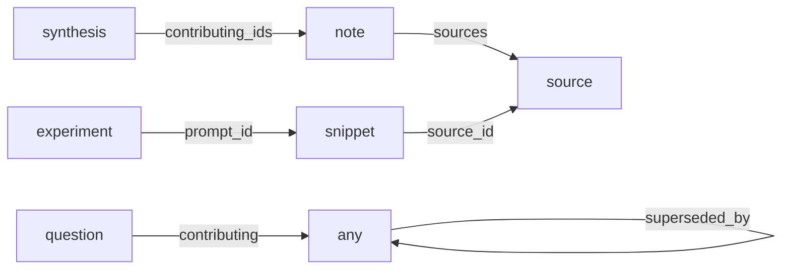

# Reference

The README explains what research-vault is. This page is for looking things up. It is a command overview with the flags you'll actually reach for. Running `research-vault` with no arguments prints the command list.

## Scope

research-vault is for *external* facts: documentation, API behaviour, tool-version claims and the decisions you made because of them. It is not a code indexer beyond the comments that cite the vault, and does not replace the agent's view of your repo. Without Node, an agent can still read a vault by globbing and grepping the folders; the CLI is the checked path.

## Releases

`.github/workflows/release.yml` runs after the `ci` workflow completes. Only a successful push run on `master` in `andrew-brooks-GA/research-vault` can release; pull-request runs cannot. Checkout and the release target use that CI run's `head_sha`. `package.json` and `.claude-plugin/plugin.json` must carry the same non-empty version. The plugin's entry in `.claude-plugin/marketplace.json` must match that version only when it carries a version; an absent marketplace version is accepted and logged. After that check, an existing `v<version>` release ends the job successfully; otherwise the job creates it using the nonempty matching section of `CHANGELOG.md`. This check runs after every eligible CI completion, even when `package.json` did not change.

GitHub uses the default branch's copy of a `workflow_run` workflow. Changes on another branch therefore need their first live verification after reaching `master`.

## Where the vault lives

Tooling and vault data are separate by default. The vault is discovered in order:

1. `--vault <path>` flag
2. a repo's `.research-vault.json` (project binding, subject to the discovery rule below)
3. `$RESEARCH_VAULT_PATH`
4. the config pointer `init` writes when it sets the default vault (first `init`, or `--set-default`)
5. the OS default: `$XDG_DATA_HOME/research-vault` (else `~/.local/share/research-vault`) on Linux, `~/Library/Application Support/research-vault` on macOS, `%LOCALAPPDATA%\research-vault` on Windows

## Skills and slash commands (Claude Code)

Each skill's description says when it applies.

| Skill | Job |
|---|---|
| `research-vault-usage` | Searching, citing with a freshness check, planning the entries a synthesis needs |
| `research-capture` | Writing a new entry by hand, with the dedup and supersede-not-rename steps |
| `research-verify` | Walking through re-checking a stale entry |
| `research-librarian` | Read-only curation guidance |
| `research-orchestrate` (`/research`) | A fresh research task end to end: vault first, then the web, every finding filed as entries |
| `research-authoring` | Use when a citation is about to land in prose you're writing in a vault-bound repo |
| `research-review` | Auditing an existing document or corpus against the vault |
| `research-teach` | Teaching a topic over sessions: resources and facts in the vault, evidence probed or read from stored sources, lessons in one of four shapes (`concept`, `tool`, `diagnose`, `project`), plus review lessons and checked tasks (a project lesson graded by `check.sh` against its `requirements.json` and run with `teach check`, with `setup.sh` and `solution.sh` beside it, validated fresh-fails and solved-passes), checked by `teach lint`, read by a fresh `lesson-reader` agent, then gated by a fresh `claims-reviewer` agent, quiz attempts recorded by a local quiz server (`teach serve`) |
| `research-claims-gate` | Gating a draft that cites the vault: derives the evidence list, dispatches one fresh `research-vault:claims-reviewer`, records the verdict in the claims ledger |

Slash commands, all under `/research-vault:`: `research-init`, `research-search`, `research-related`, `research-lint`, `research-compile`, `research-obsidian`, `research`. Every skill is also `/research-vault:<name>` (for example `/research-vault:research-capture`).

## Binding a repo to a vault

<!-- evidence: 2026-11-11-claims-gate-cuts-md-draft-into 2026-11-11-claims-gate-git-worktree-binding-ledger 2026-11-11-claims-gate-markdown-units-md-draft 2026-11-11-clean-up-probe-one-binding-check 2026-11-11-corrected-lab-block-code-doc-quotes 2026-11-11-gate-ledger-hook-embedding-gate-runs 2026-11-11-issue-60-decisions-user-confirmed-0 2026-11-11-research-vault-issue-60-hooks-carry 2026-11-11-task-6b-claims-gate-skill-runs 2026-11-11-task-6b-final-staged-code-img 2026-11-11-task-6b-image-gate-runs-workspace 2026-11-11-task-6b-reviewer-lines-behind-claims 2026-11-12-claims-gate-item-2-evidence-filter 2026-11-12-lines-behind-claims-gate-item-2 2026-11-12-lines-behind-claims-gate-scope-plan 2026-11-12-reviewed-lines-spec-49-commit-1 2026-11-12-reviewed-spec-49-commit-1-lab 2026-11-17-trial-issue-72-items-12-13 2026-11-17-gate-label-stop-hook-sessionstart-reviewer 2026-11-11-post-edit-pre-web-hook-runs 2026-11-16-usage-log-holds-search-text-after 2026-11-18-lines-behind-commit-3-plan-issue 2026-11-18-probe-commit-3-plan-issue-79 2026-11-18-second-probe-commit-3-plan-issue 2026-11-18-third-probe-commit-3-plan-issue -->

Run `init --project` at the root of a repo to write `.research-vault.json` there, and commit it. From then on:

- **Discovery.** The CLI finds the nearest binding by walking up from the working directory. A relative `vault` is relative to the binding's folder. An acknowledged binding may name a vault anywhere; run `research-vault trust` in that project to approve it (`init --project` acknowledges the binding it writes). Otherwise the vault must resolve inside that folder or to one of the user's own locations (`RESEARCH_VAULT_PATH`, the config pointer or the OS default). An unacknowledged binding naming an outside vault that is not one of those choices is refused without falling back. A command whose bound vault is refused reports the binding path on stderr and exits 2. The hooks skip work that depends on that vault; the Stop hook reports the skip and does not block. `--vault` bypasses vault discovery, but `check`, `embed` and `search --semantic` still load the binding and exit 2 if it is not valid JSON; plain `search` ignores that binding error and exits 0. The plugin takes `RESEARCH_VAULT_PATH` as the user's choice. Absolute binding paths whose first two characters are each `/` or `\` are compared with those choices by normalized spelling; other paths use resolved locations, including missing tails after an existing prefix. With no `vault` in the binding, discovery continues with the environment variable, config pointer and OS default. For discovery the binding selects the vault; what an agent does with it comes from the vault's `AGENTS.md`.
- **`research-authoring`.** When a citation is about to land in prose you're writing in the repo, the skill tells the agent to search the vault first, check a found entry's freshness, capture what the vault is missing, and run `check` on the file after writing.
- **`check`.** Audits the repo's docs against the vault; each citation is `ok`, `stale` or `uncovered`. `check --check` exits non-zero so CI can fail on stale or uncovered citations, or on a glob that matches no file.
- **Gate.** Lessons, reference docs and the `README.md` of every teach workspace (a directory holding `MISSION.md`) found under the repo are gated, plus any file matching the optional `gates.globs` array in `.research-vault.json`, for example `"gates": { "globs": ["docs/**/*.md"] }`. The `research-claims-gate` skill records each `PASS` or `MERIT` verdict with `gate record` in `.research-vault-ledger.jsonl` at the repo root, keyed to the file's content hash and to a hash per unit, so an edit that changes a unit needs a new verdict for that unit, while an edit that leaves every unit's hash unchanged keeps the earlier verdict (`(by unit)`). `gate evidence` ends with a `review hash: <hash>` line, the sha256 of what a row for the file would store (its content hash and every unit hash, so an image, a loaded script or a requirements file too), and the skill records with `gate record <file> <verdict> --expect <hash>`, which exits 1 with one line on stderr and appends nothing when that hash has changed since; a row recorded without `--expect` carries `"manual": true`, which no verdict check reads, so it and every earlier row count as before. The row also carries `reviewer`, the sha256 of the plugin's `agents/claims-reviewer.md`, and counts only while that hash is absent (no reviewer hash was recorded) or equal to the installed reviewer's; after a change to the agent file, `gate status` prints `none (reviewer changed)` for a file whose passing rows all came from the earlier one. When the changed units of a file with no verdict cite ids the bound vault does not hold, `gate status` and `gate staged` also print how many, as in `none (2 cited ids not in this vault)` or `none (reviewer changed; 2 cited ids not in this vault)`, and the Stop hook's line for that file begins with the count: a reviewer reading those units here finds no entry for those ids until the evidence is rebuilt in this vault. A lesson's units are its `data-block` elements (the fact block per paragraph, the quiz per item; every repeated block, including fact and quiz, gets a whole-inner-HTML `<name>#N` unit with the first available `#2`, `#3`, … suffix that is not a real block name), `rest` for all remaining page markup and text (including block tags and attributes, and canonical quiz JSON with items replaced by markers), `script:<src>` for each loaded local script in the served workspace folders `lessons/`, `reference/`, `assets/` and `brand/` (the resolved workspace-relative path plus file bytes, or a distinct missing-file marker with the path; repeated tags get suffixed names too) and one `img:<src>` per ``, hashed over its `<figure>` and the image file's bytes (a change to the file alone reopens only that unit, and a caption or alt change also reopens the data-block holding the figure, or for a `fact` block the paragraph holding it (a figure between `fact` paragraphs also reopens `rest`); a changed image file leaves its page without a verdict in `gate status`, a staged image file puts its page, when git tracks it, in front of `gate staged`, also when the file is gone from the working tree though not when its deletion is staged, and a changed one puts its page in front of the Stop hook only while the file still exists, so the hook does not see a deleted one); a Markdown file's (a path ending in `.md`, cut this way whatever HTML it quotes, `data-block` attributes included) are its ATX (`#`) heading sections (`sec:<slug>`, `sec:preamble` before the first heading) and each table row of one (`sec:<slug>/<first-cell slug>`, so a one-row edit reopens only that row), and `gate evidence --changed` prints `unit sec:<slug> <file>:<start>-<end> prose` for each changed one so the reviewer reads only those, and lists only the citations inside those units, plus `--extra` (a changed row with none takes those of its section's lines outside rows; a changed unit with none, or no changed unit, gives the whole file's); a file with neither is one unit, `all`. A script unit is satisfied when a passing row covers its hash or its bytes equal the plugin's current `skills/research-teach/<path>` copy; a passed older workspace copy remains satisfied after a plugin upgrade. An exact-page-byte legacy row without a script hash leaves that script pending unless it equals the current shipped copy. Local script files also select their pages: for `gate staged` (pages git tracks) when staged, present in the working tree or not, and for the Stop hook when they exist and changed. A checked task's lesson hashes its `step` unit over the block and the bytes of `evidence/NNNN/requirements.json`, where NNNN is the lesson's number. A requirements file that resolves outside the workspace or cannot be resolved is treated as absent. An edit to that file reopens only the `step` unit and leaves the lesson without a verdict in `gate status`, unless the lesson's passing row was written before rows held a hash per unit. A staged requirements file that resolves inside the workspace puts its lesson, when git tracks it, in front of `gate staged`, present in the working tree or not, and a changed one puts it in front of the Stop hook only while it exists and resolves inside the workspace. Unless a binding or versions-file refusal causes it to report a skipped gate without blocking, the Stop hook blocks a turn that leaves a changed gated file without a `PASS` or `MERIT` verdict for its current content (a row for those exact bytes while no image it references or requirements file of the lesson has changed, a requirements file change aside for a row written before it held that unit, and each local script has bytes passed in a row or equal to the plugin's current copy, or every unit covered by some row or that script exemption). After an edit to a gated file or one matching `references.globs`, a hook reports its uncovered or stale citations without blocking, unless a binding or versions-file refusal makes it skip that advice; an edit inside the vault runs `lint --fix` instead, so this applies to files outside the vault. `gate status <file> --check` exits 1 when the current content has no passing verdict; `gate staged --check` does the same for the staged content of every gated file staged in git, one line per file, for a pre-commit hook (the plugin repo ships one in `.githooks/`), and a page whose referenced image, loaded local script or requirements file differs between the index and the working tree, or is untracked, has no verdict there, and its line reads `none (<repo-relative path>: staged and working copies differ)`. With no `.research-vault.json` in the working directory or above it, `gate staged` (with or without `--check`) prints `staged gated files: none (no .research-vault.json binding here, so nothing is gated)` to stdout and exits 0. An entry of that name that cannot be read (including a broken link), invalid binding JSON, a refused vault, a git repository that cannot be inspected, or a staged file git cannot read still reports an error on stderr and exits 2. A vault entry outside any bound repo can be gated too; its ledger lives in the vault.
- **Embedding endpoint.** `"embedding": { "url", "model"?, "chunk"?, "overlap"? }` (defaults 800 and 100) turns on `embed`, which writes the disposable index `_index/embeddings.jsonl` from every non-superseded entry's windows, and `search --semantic`; both need `RESEARCH_VAULT_ALLOW_NETWORK=1`, `--ack-data-egress` and `RESEARCH_VAULT_EMBED_URL` matching `embedding.url` after URL parsing. The endpoint must use HTTPS or loopback HTTP and have no user-info. Requests refuse redirects. After argument checks (`search --semantic`) and binding loading (an error exits 2), the embedding gate reports its first refusal on stderr and exits 1, in this order: no embedding block, missing network opt-in, missing acknowledgement, user-info in the URL, missing or mismatched endpoint approval, then non-loopback HTTP. These checks precede vault discovery and text collection. The plugin takes the approval variable from the environment as the user's choice; URL parsing ignores scheme and host case, a default port and an empty path. See [SECURITY.md](../SECURITY.md#embedding-endpoint-embed-search---semantic) for the exact diagnostics. Without the block, both refuse (`no embedding endpoint in .research-vault.json`) and no index is written.
- **Lab.** An optional `"lab": { "docs", "uses", "bypass" }` block, each a non-empty array of non-empty strings, for example `"lab": { "docs": ["LAB.txt"], "uses": ["lab/lib.sh"], "bypass": ["kind create cluster"] }`. `docs` lists the files that explain the repo's lab, relative to the directory holding `.research-vault.json` (an absolute path or a `..` segment is rejected); `uses` and `bypass` are literal strings, not patterns. With the block, `teach lint` reads every `.sh` file under the workspace's `labs/`, `evidence/` and `lessons/` and reports the advisory `WARN_LAB_BYPASSED` for a file that holds a `bypass` string on a non-comment line, quoted strings read as empty, and no `uses` string outside a comment or an `echo` line, unless the file is under `evidence/NNNN/` or `lessons/files/NNNN-` and `evidence/NNNN/PLAN.md` has a line starting `own environment: <reason>`; a script under `labs/` is never silenced (LESSON-FORMAT.md has the rule). Plugin version 0.11.0 is the first that reads the block; 0.9.0 (the older version run) drops it silently, as it drops a misspelled key. A malformed block throws `invalid .research-vault.json: lab ...` (`lab must be an object`, or `lab.<field> ...`): a CLI command that resolves its vault from the binding exits 2, while the hooks catch the error and carry on.
- **Usage log.** `_index/usage.jsonl` in the vault, one JSON object per line: a `queried` event from the pre-web hook (the tool, the outcome `url-hit`, `hits` or `no-match`, the ids surfaced) and from `search` (the `--type` and `--topic` facets, the outcome, the ids returned), and a `cited` event per id a watched file newly cites, from the post-edit hook (the file's repo-relative path and the id; the log itself is the record of what was already logged). An append requires the log and its directory to resolve inside the vault. Ids, facets and the outcome are always written; free text (the pre-web terms, the `--text` value) only when the binding sets `"usage": { "text": true }`. The template's `.gitignore` already ignores `_index/`; if a vault's `.gitignore` lacks the line, add it. `advise` reads the log for its usage section and skips a line that is not JSON.

### Code links

A vault id on a comment line of its own, above a column-0 declaration, cites that entry for the symbol below it. The id may carry a pin, `<id>@<key>=<version>`, naming a key of `code.versions` and the version the code was checked against:

```lua
-- Sleep-mode call order per 2026-03-03-sleep-mode-api@sdk=0.20
function ns.Sleep(frame)
```

Blank and comment lines may sit between the comment and the declaration; several ids on one line, or several comment lines above one declaration, are several links to the same symbol. A link whose next non-blank, non-comment line is not a column-0 declaration is `unattached`: reported, never dropped.

**Opt-in.** `init --project --vault <relative dir> --code-links '<glob>[,<glob>]'` writes the standard binding plus a `code` block, and a `code` block written by hand into an existing binding is the same opt-in. The block is accepted only on a relative `vault` inside the repo: an absolute, empty, `..` or absent vault is rejected with `code links need a project-specific vault inside the repo (a relative vault path); this binding points at <vault>` (`(none)` when the vault is empty or absent). Without the block, `check`, the gate and the hooks take today's code path and the comments are ordinary comments. Windows cmd.exe keeps single quotes, so there write `--code-links "src/**/*.js"`; a glob that starts or ends with a quote is refused by `init` and `check` with exit 2.

```json
"code": {
  "globs": ["src/**/*.lua"],
  "languages": {},
  "versions": {
    "sdk": { "file": "package-lock.json", "pattern": "\"node_modules/sdk\": \\{\\s*\"version\": \"([^\"]+)\"" }
  }
}
```

- **`versions`.** Each key names a `{ file, pattern }`. The binding rejects an empty or absolute `file`, a drive specifier or a `..` segment. Before reading, `check` follows links and requires the file to resolve inside the repository. The pattern is a JavaScript regex applied with the `m` flag to the whole file; the first capture group of the first match is the declared version. An out-of-repository or unresolved file makes `check` print `error: versions.<key>: <file> resolves outside the repository` on stderr and exit 2; the post-edit hook skips its stale-link advice if this reader fails. A file that is missing or that the pattern does not match is a configuration error (`check` exits 2 with `versions.<key>: cannot read <file>` or `versions.<key>: pattern matched nothing in <file>`), not a row per link. `package-lock.json` nests the installed version under `packages[<path>].version`. One-line forms: the `## Interface:` line of an addon `.toc`; a `go.mod` `require` line, which declares a minimum version while the selected version may be higher; a `.minimum_zig_version` line in `build.zig.zon`. `check` prints the values it read as a footer, `versions: sdk=0.20`.
- **`languages`.** A language is `{ comment, decl }`, two regex sources: `comment` matches one whole comment line and captures its text in group 1; `decl` matches one column-0 declaration line and captures the symbol name in its first non-empty group. Each must compile and hold a capture group, else the error names the field (`code.languages[".py"].decl: pattern has no capture group`). The plugin ships rows for `.lua`, the JavaScript and TypeScript family (`.js`, `.mjs`, `.cjs`, `.jsx`, `.ts`, `.mts`, `.cts`, `.tsx`), `.py`, `.go`, `.rs`, `.zig`, `.rb`, `.sh`/`.bash` and C/C++ (`.c`, `.h`, `.cpp`, `.hpp`, `.cc`, `.hh`); each sees only column-0 declarations, so a method inside a class body, or a decorator or attribute line between the comment and its declaration, is not seen. The Lua row:

  ```js
  comment: /^\s*--(?!\[=*\[)(.*)$/,
  decl: /^(?:local\s+)?function\s+([A-Za-z_][\w.:]*)\s*\(|^(?:local\s+)?([A-Za-z_][\w.]*)\s*=(?!=)/,
  ```

  A project adds any other language as a row keyed by extension in `code.languages`, and may override a shipped row; a `code.globs` file whose extension has a row from neither is a configuration error, `no language for .kt in code.globs; add code.languages[".kt"] = { comment, decl }`. `comment` is matched line by line, so a block-only comment syntax needs a line prefix inside the block.
- **Statuses.** A code row is `ok`, `uncovered` (no entry for the id), `unattached`, or `stale` with its reason: `(time)` for an unpinned link whose entry is past its volatility window, or a pinned link to a `volatile` entry; `(superseded by <id>)` for an entry with `status: superseded`; `(<key> <pinned> -> <declared>)` for a pin that differs from the declared version; `(no key <key> in code.versions)`. A pin selects the version rule over the time rule; an unpinned link follows the entry's window as prose does. `check --check` exits 1 on any `stale`, `uncovered` or `unattached` row, or when a glob matches no file.
- **Gate.** Each linked declaration is a unit, `sym:<name>`, hashed from its leading comment block to the line before the next column-0 declaration's comment block, with pin values stripped, so moving the block, editing a neighbour or moving a pin reopens nothing and editing the body does. Code files with an attached link are gated like `gates.globs` files; `gate evidence <file> --changed` adds one line per changed unit, `unit sym:<name> <file>:<start>-<end> <status>`, which the `claims-reviewer` reads as its line range. Unless a binding or versions file is refused, the post-edit hook reports a code file's non-`ok` rows and, after an edit to a `versions` file, every link whose pin differs from the version now declared. The Stop hook also blocks a turn in which a `versions` file changed and a link is still pinned to another value, naming the link and the two versions; if a binding or versions file is refused, it reports a skipped gate and does not block.

## Extending the controlled vocabulary

The schema enums are small on purpose. A vault that needs its own terms (a lab recording `lab-run` as a verification method, a team with an extra `domain`) adds them in `.research-vault.json`:

```json
{
  "vault": "research",
  "taxonomy_extensions": {
    "verification_method": ["experiment", "lab-run"],
    "verification_result": ["partial"],
    "topic_aliases": { "k8s": "kubernetes" }
  }
}
```

- **Additive only.** You can add values, never remove or redefine a built-in, so entries stay portable between vaults.
- **Extensible fields:** `domain`, `confidence`, `outcome`, `question_state`, `verification_method`, `verification_result`. `volatility` and `stage_by_folder` are not extensible, and `topics:` already accepts any tag.
- **`topic_aliases`** is a map of vault pairs, alias to canonical topic, merged after the built-in pairs; a pair whose key is a built-in alias is refused. `capture`, `lint`, `advise`, `search` and `teach path candidates` all read the merged map, and `lint --fix --topics` rewrites existing entries.
- **Keyed on the vault**, not your shell's working directory, so the vocabulary is the same wherever a command runs.

To change the built-in vocabulary itself, edit `schema/taxonomy.json`. The linter, `capture`, the generated `AGENTS.md` and each vault's copied `taxonomy.json` all derive from it.

## Freshness

Each entry has a `volatility` tier with a review interval. An entry is stale when its last confirming verification is older than the interval.

| tier | covers | interval |
|---|---|---|
| `stable` | fundamentals, algorithms, classics | 3 years |
| `slow` | established practices, mature frameworks | 1 year |
| `fast` | specific tool APIs, framework versions, LLM capabilities | 90 days |
| `volatile` | pricing, rate limits, current best model, availability | always re-check |

A note or synthesis is only as fresh as its evidence; `advise` reports conclusions whose source chain reaches a stale or replaced entry.

## Versions and replacements

These are different things:

- **A new version of a tool is new knowledge, not a correction.** `vcluster 0.19` and `0.20` are two active entries sharing a `series`. Record this with `verify --succession` on the older entry, then capture the newer version as its own source with `--subject-name`, `--subject-version` and `--series`.
- **A replacement is for an entry that is wrong or obsolete.** Capture the corrected entry first, then `verify --id OLD --method <method> --result outdated --superseded-by NEW`. The old entry stays on disk with `status: superseded`; `search` hides it unless `--include-superseded`, and `related` still shows it so the evidence trail stays visible.

## Entry types and the graph

| Folder | Holds | Create one when |
|---|---|---|
| `sources/` | Raw captures of external material, as-is | you clip something worth keeping |
| `notes/` | Your distilled take on one or more sources: the load-bearing claims and how you'd use them | you read a source and want a durable, skimmable version |
| `synthesis/` | Conclusions drawn across several entries | you see a pattern worth stating once |
| `snippets/` | Reusable code or prompt fragments | you have a fragment you'll reuse |
| `experiments/` | Logged trial runs with task, parameters and outcome | you run a trial worth recording |
| `questions/` | Open questions (`open → investigating → answered`) | you hit something to track and answer over time |

Distillation (source → note → synthesis) is a deliberate step; nothing auto-promotes. A synthesis usually cites notes, and may also cite sources, experiments, questions and snippets directly; a factual rollup (a release-note matrix, a version diff) may skip notes if it declares `synthesis_basis: primary-rollup`.

Stored references point from the declaring entry to what it references:



`.vault-manifest.json` lists every reference as a typed edge and inverts the backlink-forming ones. Each vault's generated `AGENTS.md` §5 documents the fields and §5.2, Asking the graph.

### Reading the graph from outside

A project that keeps its own graph (a code dependency map, a Neo4j load, a Graphviz script) does not need the plugin's view of it. Two outputs carry everything, both plain JSON, neither stored in git, so run the command first:

- **The vault graph**: `lint` writes `<vault>/.vault-manifest.json` with `generated`, `entries`, `edges` and `backlinks`. An entry row has `id`, `type`, `title`, `summary`, `domain`, `topics`, `source_url`, `content_hash`, `volatility`, `last_verified`, `status`, `subject`, `series`, `stage`, `state`, `confidence`, `outcome`, `authority_tier`, `authority_basis`, `superseded_by`, `related`, `contributing_ids` and `sources`; an absent field is `null` or `[]`, never missing (`status` defaults to `active`). An edge is `{ from, rel, to }` with `rel` one of the reference fields above, sorted by `from`, `rel`, `to`. `backlinks` maps an id to the sorted ids that reference it through a backlink-forming field. Bodies are not included: the id is the filename under the type's folder.
- **The code edges**: `check --json` from the repo root prints `generated`, `summary`, `rows`, `skipped` and, with a `code` block, `versions`. A code row has `file`, `type`, `value`, `symbol`, `line`, `key`, `version`, `status` and, when covered, `id` and `volatility`, plus `reason` when stale; a prose row has `file`, `type`, `value`, `status` and, when covered, `id` and `volatility`. Join a row's `id` to an entry's `id` and the code side of the graph is complete.

These keys are the integration contract: `test/contract.test.mjs` pins them, and a change is a breaking one in the CHANGELOG. `examples/graph-dot.mjs` is the join written out as Graphviz DOT, and `examples/blast-radius.mjs` is the other direction: given the manifest, one entry id and one or more `check --json` outputs, it walks the `sources` and `contributing_ids` edges inward and prints the entries that rest on the id and every row that cites one of them, which is what to re-check when the entry is superseded; [ADOPTING.md](ADOPTING.md) is the ordered walkthrough for a new project.

Two facet tiers keep retrieval clean as a vault grows: **`domain`** is a small controlled set of broad areas (`software-engineering`, `systems-infrastructure`, `data-ml`, `security`, `learning`, `llm-assisted-dev`, `meta`, `natural-science`, `humanities`, `business-finance`, `health-fitness`, `language-learning`, `arts-crafts`); **`topics`** is freeform and is where specific tech lives.

## Commands

Run as `node bin/research-vault.mjs <command>` from a clone, or `research-vault <command>` if you've put it on your PATH. Every command takes `--vault <path>`. For example:

```text
research-vault capture --type source --title "vcluster sleep mode" \
  --url https://example.org/sleep-mode --domain systems-infrastructure \
  --topics kubernetes,vcluster --subject-name vcluster --subject-version 0.20
research-vault search --topic vcluster
research-vault verify --id <id> --method refetched-source --result confirmed
```

Ids are `<date>-<slug>`; use the one `capture` or `search` prints rather than guessing it.

| Command | Does |
|---|---|
| `trust` | `[--show] [--revoke] [--yes] [dir]` records, shows or revokes acknowledgement of the nearest binding. An acknowledged binding may name a vault anywhere; without acknowledgement an outside vault must match a user choice or discovery refuses it. Displays the canonical binding path and exact UTF-8 file text (including duplicate keys), with byte and line counts. Non-printable-ASCII code units are escaped as `\uXXXX` and literal backslashes are doubled; file, value and error lines have fixed prefixes and wrap at 76 characters including each prefix. Newlines are shown as escapes at the end of each source line; the line count includes the final empty segment after a trailing newline. `Resolved vault:` uses the folder where the binding was found, with `Real vault:` when different. If resolving from the real binding folder differs, `Binding-folder vault:` and, when different, `Real binding-folder vault:` show that location too, followed by `Linked folder: vault locations differ depending on the path.` Each location gets a missing-location notice when absent; values starting with two slashes or backslashes print `Vault location was not looked up.` without a real-location lookup. Refuses non-object JSON, invalid UTF-8 and non-regular binding final names (including links). `--show` wins over `--revoke`; both win over `--yes`. Revoke prints the binding identity and works even when its content is invalid or unreadable. Trust stops at a dangling binding link and refuses it, unlike hook lookup, which skips it. Neither mode acknowledges. Without a terminal, recording requires `--yes`. Confirmation pins both canonical identity and bytes; the user config folder holds `trusted-bindings.json`: `{ version: 1, bindings: [{ path, sha256, date }] }`, with paths formed from the native real location of the binding folder plus its final filename, SHA-256 hashes of their bytes and ISO dates. Changed bytes require acknowledgement again. Queries and writes refuse a linked config folder or record, and non-regular records; a linked parent of the config folder is allowed. |
| `init` | Scaffold a vault and generate its `AGENTS.md`. `--project` creates the current repo's binding exclusively and refuses an existing file or link. It records an acknowledgement of the binding it writes; if recording fails, the binding remains and stderr points to `research-vault trust`. It warns if the vault it writes into the binding would be refused during discovery; with `--code-links '<glob>[,<glob>]'` it also writes the `code` block, which needs a relative `--vault` inside the repo. `--refresh-docs` regenerates `AGENTS.md` and `taxonomy.json` in an existing vault and touches nothing else (entries and `meta/` are preserved). |
| `capture` | Add an entry. Required: `--type`, `--title`; sources also `--url`, notes also `--sources`, syntheses also `--contributing-ids`. Common: `--domain`, `--topics a,b`, `--subject-name`/`--subject-version`/`--series`, `--summary`, `--confidence`. Dedupes by URL and version. `--scaffold` writes a per-type body skeleton; `--body-file` supplies prose for non-source types; `--content-file` and `--captured-via` record local provenance; `--store-body` keeps the text you pass with `--content` or `--content-file` in a source entry and needs `--ack-data-egress`; a single capture never fetches the URL itself. `--fill <id> --ack-data-egress` is the form that fetches for a source already in the vault: when the entry holds under 200 characters of text and `RESEARCH_VAULT_ALLOW_NETWORK=1` is set, it fetches the page, stores its extracted text in the entry and appends one verification row whose note begins `filled:`. When it runs, it prints one result, `filled`, `kept` (the entry already holds text), `refused`, `version-floating`, `unreachable`, `no-text` or `too-large`, as one JSON object with `--json`; for a source that holds no text and passes the address checks, it exits 2 with an `error:` line without `--ack-data-egress`, or with the network off and no `--content-file`. `--fill --replace` fills again over a text a fill wrote, `--fill --discard` removes such a text, and `--fill --content-file <file>` takes the text from a saved `.html`, `.htm`, `.txt` or `.md` file with no network. `--batch <path>` takes a JSON plan (an array of specs), a URL list (one per line, `#` comments; needs `RESEARCH_VAULT_ALLOW_NETWORK=1` and fetches each through the `refresh` fetcher) or a directory of Markdown files (`source_url` or `url`, `title` and `author` from frontmatter, else the first link and the first heading); it validates every entry before writing any, reports duplicates as skipped and failures with a reason per item, writes nothing on a validation failure unless `--continue`, which writes the rest (a filesystem failure can leave partial output either way), and `--store-body --ack-data-egress` keeps the fetched or read text. A source whose URL matches `meta/source-blocklist.json` in the vault (rows `{ pattern, scope: url | domain, reason, added }`; a `domain` row covers its subdomains, a `url` row is a prefix after normalisation) is refused with the reason; `--force` captures it and records the override in the `captured` verification's notes; in `--batch` a match is the item's error. <!-- evidence: 2026-11-17-capture-operation-lines-research-vault-issue 2026-11-17-quote-verify-gate-lines-research-vault 2026-11-17-probe-capture-verify-capture-operation-gate 2026-11-17-probe-cli-behaviour-research-orchestrate-skill 2026-11-17-second-probe-log-capture-verify-writes --> |
| `lint` | Validate the vault and, unless `--check` is set or an entry has a `PARSE` or `FIELD_SHAPE` violation, attempt to rebuild the manifest; `lint --check` also skips comparison with the stored manifest when either violation is present. A manifest destination or shrink refusal exits 2 before the collected warnings print. `--check` for CI (exits non-zero on violations or a stale manifest). Linked type folders and entry files whose targets are outside the vault or cannot be resolved are skipped with `WARN_ENTRY_LINK_SKIPPED`. `--fix` applies safe normalizations to the entries that pass that check; `--fix --topics` also rewrites each aliased topic to its canonical value (built-in and vault pairs) and deduplicates the list. A source matching `meta/source-blocklist.json` warns `WARN_SOURCE_BLOCKED`; a list that does not parse is the violation `BLOCKLIST_INVALID`. |
| `verify` | `--stale` lists entries past their interval. `--id <id> --method <m> --result <r> [--notes]` records a check. `--result outdated --superseded-by <id>` replaces; `--succession` records the check and keeps the entry active for its version, printing the `capture` line for the newer version's sibling entry. `--id <question> --answered-by <id> [--answer-summary <text>]` closes a question: `state: answered`, the summary (the answering entry's `summary` when the flag is omitted) and the id appended to `contributing`, with no verification row. `--id <source> --quotes <file> [--run <key>]` checks quotes against a source's text: the file is a JSON array of quotes, and for each the command prints whether it is on one line of the text, or over adjacent lines with no blank line between them (differences of white space, quote marks, dash forms and backticks aside), every line it starts on and the lines around the first. A quote under four words or twenty characters is refused. A quote found adds one `quote-matched` row, once for a quote however often the command runs: `inconclusive` when it is found in the stored body, `confirmed` when it is found on the page. The page is fetched, in memory, only with `RESEARCH_VAULT_ALLOW_NETWORK=1` and only when the entry holds no stored text or its text lacks the quote; the body and `content_hash` are not changed. `--run` puts a run key (`run-` and six or more letters or digits) in the row of a quote found in the body. `--method quote-matched` is refused, and `lint` and `advise` count a `quote-matched` row as they count `captured` when they decide whether a source is unverified. <!-- evidence: 2026-11-17-quote-verify-gate-lines-research-vault 2026-11-17-probe-capture-verify-capture-operation-gate 2026-11-17-second-probe-log-capture-verify-writes 2026-11-17-capture-operation-lines-research-vault-issue --> |
| `search` | `--type`, `--domain`, `--topic`, `--series`, `--text` (title, topics, summary), `--body`, `--json`. Superseded entries are hidden unless `--include-superseded`. `--sort authority` orders by the taxonomy's tier array with untiered rows last; `--sort fresh` orders fresh, then stale, then not assessable; ties keep manifest order, the default. Each text line ends with `(<tier or no tier>, fresh|stale)`, followed by `(superseded by <id>)` on a superseded row shown with `--include-superseded`; the freshness part is absent when freshness cannot be assessed (`staleness()` returns null). `--semantic <text>` ranks the facet-filtered, non-superseded rows by the best cosine between the query's embedding and their indexed windows, a stale row's score multiplied by 0.8, cut to `--limit` (default 10); each line ends with `score <n.nn> #<window>`, `--json` adds `score` and `chunk`; it requires the binding's `embedding` block, the three gates in the binding's embedding rule and an index (`run embed first`), and cannot be combined with `--sort`, `--text` or `--body`. A usage-log destination that fails the vault containment check is reported on stderr and the results still print. |
| `related` | Typed links for an entry. `--depth N`, `--direction` (`out`, `in` or `both`), `--rel a,b`, `--format mermaid`. |
| `advise` | Report (in a run, every file of the vault kept its sha256): stale entries, stale evidence chains, orphans, sources without notes, unverified sources, missing summaries, aliasable topics, stub bodies, quote residue, open questions past 60 days, supersede suspects (two live entries of one type at one subject version with one `source_url` or one subject name, or with one `source_url` when only one of the two has a subject version), near duplicates (two live sources at different normalised URLs, either on one host sharing more than half of the longer path's segments, or whose titles share at least two terms, more than half of the longer title's terms), usage (for each entry surfaced or cited at least once, the two counts, per queried topic the query and no-match counts, and the live sources never cited, split by whether one of their topics was queried; read from the usage log). `--json`. <!-- evidence: 2026-11-17-advise-librarian-skill-lines-working-tree 2026-11-17-capture-dedup-advise-pair-lines-issue 2026-11-17-advise-scratch-vault-writes-nothing-sha256 --> |
| `manifest` | Rebuild (`--rebuild`) or print the derived index. `--topics` (no value) lists the topic vocabulary in place of the JSON, one `<topic> <count>` line per topic on a non-superseded entry, sorted by topic; with `--rebuild` it follows the rebuild's count line. `--rebuild` reports each edge to a missing entry on stderr before writing, and refuses to write when an entry the current manifest lists would be dropped while its type folder is missing or its file is still there, unless the folder or file resolves outside the vault (`manifest not written: ...`; delete `.vault-manifest.json` to accept the shrink). |
| `compile` | Regenerate the human-readable `_index/` (git-ignored, derived). |
| `obsidian` | Regenerate `_obsidian/` (git-ignored, derived). Open that folder, not the vault root, as an Obsidian vault; stubs carry `type/`, `status/`, `domain/`, `volatility/`, `freshness/` and `topic/` tags, so a graph filter like `tag:#freshness/stale` colours what matters. In a repo bound with a `code` block, `_obsidian/code/` holds one note per linked code file (tag `type/code`) with a wikilink per code link, so the graph shows which code cites which entry. `--out` (default `_obsidian`) must resolve inside the vault and outside the canonical entry folders, with neither the vault root nor a path inside an entry folder accepted by normalized spelling. A canonical entry folder must also be known to resolve outside the output directory. Existing segments below the vault root through the output directory must be directories, with no symbolic links or junctions; the vault root may itself be linked. Missing output parents are created. Each destination is checked against the resolved output directory immediately before writing; an outside or unresolved destination is refused. See [Local writers](../SECURITY.md#local-writers) for the checks and [Threat model in one line](../SECURITY.md#threat-model-in-one-line) for their limits. The first run seeds `_obsidian/.obsidian/graph.json` (MOC hidden, colours by type, stale red); edit it in Obsidian as you like, later runs keep it. |
| `check` | Audit a document or glob outside the vault. `--report` or `--json` emit a coverage matrix; `--check` exits non-zero on a stale or uncovered citation, or on a glob that matches no file (named on stderr, with or without `--check`). URLs and ids inside code spans and fenced blocks are not citations; a value found only in code is reported as skipped. A fence left unclosed makes the rest of the file code, and `check` lists a URL found only there as skipped. With a `code` block in the binding, files matching `code.globs` are read for code links instead (one row per link, printed as `file:line symbol`), the summary gains the `unattached` and code-link counts, and a `versions:` footer lists the declared versions; with no positional glob, `references.globs` and `code.globs` are both checked, resolved against the binding's folder (a positional glob is relative to the working directory). Read-only, no network. |
| `gate` | `gate evidence\|changed\|record\|status\|staged`: derive a draft's evidence list from the vault, with one `image: <workspace-relative path> sha256:<hash>` line per readable png, jpg, jpeg, gif, svg or webp file a lesson or reference page references, then a last `review hash: <hash>` line, `reviewHash` with `--json` (`evidence <draft> [--extra <ids>] [--changed] [--json]`; with `--changed`, a Markdown draft with headings gets the changed units' citations by the Gate rule of [Binding a repo to a vault](#binding-a-repo-to-a-vault), plus `--extra`; with `--packet <dir> --run <key>` it also writes an evidence packet into `<dir>`, an absent or empty directory that can be established to be outside the vault. It checks each copy's destination against the packet directory. The packet is a copy of the listed entries in which each source over 8,000 bytes that holds quote rows of that run is cut to the lines within three of each quote, and it is refused with one `gate:` line on stderr and exit 1, nothing written and no list printed, when a listed source has a body quote row of another run, of no run or of an earlier text of its body, or when nothing would be cut), list the units no `PASS` or `MERIT` row covers (`changed <draft>`, exit 1 when there are any), record a claims verdict keyed to the file's content hash (`record <file> <PASS\|FAIL-as-sent\|MERIT> [note] [--expect <hash>]`, with the ledger's real destination checked against its repo or vault before the append; with `--expect`, exit 1 and nothing appended when the review hash `gate evidence` prints for the file now differs, exit 2 when the value is not 64 hex characters; without it the row carries `"manual": true`), report the verdict for the current content (`status <file> [--check]`, exit 1 with `--check` when there is no `PASS` or `MERIT`), or report every gated file staged in git with the verdict for its staged content (`staged [--check]`, exit 1 with `--check` while any has none, exit 2 when git cannot be inspected; for a pre-commit hook). <!-- evidence: 2026-11-11-claims-gate-cuts-md-draft-into 2026-11-11-claims-gate-git-worktree-binding-ledger 2026-11-11-claims-gate-markdown-units-md-draft 2026-11-11-clean-up-probe-one-binding-check 2026-11-11-corrected-lab-block-code-doc-quotes 2026-11-11-gate-ledger-hook-embedding-gate-runs 2026-11-11-issue-60-decisions-user-confirmed-0 2026-11-11-research-vault-issue-60-hooks-carry 2026-11-11-task-6b-claims-gate-skill-runs 2026-11-11-task-6b-final-staged-code-img 2026-11-11-task-6b-image-gate-runs-workspace 2026-11-11-task-6b-reviewer-lines-behind-claims 2026-11-12-claims-gate-item-2-evidence-filter 2026-11-12-lines-behind-claims-gate-item-2 2026-11-12-lines-behind-claims-gate-scope-plan 2026-11-17-quote-verify-gate-lines-research-vault 2026-11-17-probe-capture-verify-capture-operation-gate 2026-11-17-second-probe-log-capture-verify-writes --> |
| `teach` | Teaching workspace verbs: `record add`, `record supersede`, `attempt add`, `attempt import`, `cast check`, `cast transcript`, `check`, `export`, `lint`, `next`, `path candidates`, `path edges`, `progress`, `readme` and `serve`, each under its own heading in [teach](#teach) below. |
| `refresh` | Re-fetch sources to see whether they changed; reports `confirmed`, `changed` or `unreachable` per source and never edits entries. Run `verify` on anything `changed`. `--json` prints one object per result, `{ id, result, detail?, storedBody? }`; `storedBody`, on a `changed` result, says whether the entry's body holds a line other than blanks, a lone `-`, lines starting with `#` or a bare ``` line (stored prose is such a line) to diff against. Needs `RESEARCH_VAULT_ALLOW_NETWORK=1`. |
| `embed` | Build `_index/embeddings.jsonl` for `search --semantic`: every non-superseded entry's windows (the binding's `chunk` and `overlap`) embedded through the binding's `embedding.url` in batches of 64; needs `RESEARCH_VAULT_ALLOW_NETWORK=1`, `--ack-data-egress` and a matching `RESEARCH_VAULT_EMBED_URL`; refuses without the block. After the requests, the index and its directory are checked to resolve inside the vault; a destination refusal exits 2, so it can follow text being sent. A failed request or unusable response exits 1 with a fixed refusal line and no response body. |
| `export` | JSONL for fine-tuning or eval, to stdout or `--out <path>` (which must be established to be outside the vault). Default: answered-question pairs. `--scope <types>` chooses which types to export instead (include `question` to keep the pairs); other types emit title and summary, and bodies need `--include-bodies --ack-data-egress`. Every record's `meta` carries `id`, `type`, `last_verified`, `topics`, `authority_tier`, `volatility` and `source_url`. `--chunk <chars> [--overlap <chars>]` emits one record per window of the output, counted in UTF-16 code units (the JavaScript string length, so a window can split a surrogate pair), with `meta.chunk` `{ index, start, end, total }` (reassemble by appending each later window from offset `overlap`); `--fresh-only` drops superseded and stale entries; `--min-authority <tier>` drops sources below the tier and keeps untiered rows. See [FINETUNING.md](FINETUNING.md). |

Four operations require a command rather than prose, by design: `lint` (correctness is checked, not asserted), `init`, `refresh` (network opt-in) and `export` (leaves the vault).

## teach

<!-- evidence: 2026-11-03-lines-behind-research-teach-skill-claims 2026-11-03-path-verbs-probe-candidates-pool-edges 2026-11-03-path-verbs-probe-runner-at-e9a1559 2026-11-03-second-lines-behind-issue-3-teach 2026-11-03-teach-row-probe-lint-exit-codes 2026-11-11-lines-behind-spec-48-teach-export 2026-11-11-research-vault-issue-66-readme-code 2026-11-11-spec-48-commit-1-review-round 2026-11-11-spec-48-commit-2-review-round 2026-11-12-third-lines-snippet-behind-spec-49 -->

The `teach` verbs, one heading each. The workspace is the positional path, which must hold `MISSION.md`, else the cwd when it holds `MISSION.md`; otherwise usage and exit 2. `teach serve` and `teach export` also require `MISSION.md` to resolve inside the workspace. Their binding lookup skips a workspace binding linked outside the workspace and continues above it; `teach next` uses this lookup when checking a contained regular README after the path is complete. The path checks have the limits in [SECURITY.md](../SECURITY.md#threat-model-in-one-line).

### teach record add

<!-- evidence: 2026-11-03-lines-behind-research-teach-skill-claims 2026-11-03-teach-verbs-fixture-workspace-at-b4b01f7 2026-11-11-clean-up-probe-two-teach-path -->

`teach record add --title <t> --kind <k> [--lesson <id>] [--body-file <path>] [workspace]`. It creates `learning-records/` if absent. An existing `learning-records/` must be a real directory at its own place in the workspace. A refused destination exits 2 before a record is written.

### teach record supersede

<!-- evidence: 2026-11-11-clean-up-probe-two-teach-path -->

`teach record supersede <id> --by <id> [--reason <text>] [workspace]`. It checks the records and the temporary file for the rewrite inside the workspace's own `learning-records/`. A link at a record or temporary file it checks is refused with exit 2.

### teach attempt add

<!-- evidence: 2026-11-03-lines-behind-research-teach-skill-claims 2026-11-03-teach-verbs-fixture-workspace-at-b4b01f7 2026-11-11-clean-up-fix-round-one-probe 2026-11-11-clean-up-probe-two-teach-path 2026-11-11-lines-behind-spec-48-teach-export 2026-11-11-spec-48-commit-1-review-round 2026-11-12-third-lines-snippet-behind-spec-49 2026-11-18-second-lines-behind-commit-4-plan 2026-11-18-probe-commit-4-plan-issue-79 2026-11-18-second-probe-commit-4-plan-issue 2026-11-18-third-probe-commit-4-plan-issue -->

`teach attempt add --lesson <id> --answers <comma list> [workspace]`, `teach attempt add --lesson <id> --result pass|fail [workspace]` (a project run), `teach attempt add --lesson <id> --answered <ids> [workspace]` (an answer given to a checked task: `<ids>` is a comma list of requirement ids of the lesson's `evidence/NNNN/requirements.json`, or `all` for every id; the attempt stores `answered`, those ids in the file's order, `total`, their number, `wrong`, every position, and in both `tested` and `records` every learning record an answered requirement names; it prints `recorded <id>: answered <ids>`, the ids joined by `, `). Exactly one of `--answers`, `--result` and `--answered`, else the usage and exit 2. With `--answered`, exit 2 with `teach attempt add: <problem>` for a `requirements.json` that is missing or invalid, with `error: no requirement "<id>" in requirements.json` for an id the file does not hold, and with `error: no requirement id given` for an empty list. A lesson must resolve inside the workspace's own `lessons/` folder. If present, `attempts/` must be a real directory at its own place in the workspace. A refused attempt destination exits 2.

### teach attempt import

<!-- evidence: 2026-11-11-spec-48-commit-1-review-round 2026-11-11-teach-attempt-import-review-round-runs 2026-11-11-teach-export-review-round-runs-spec -->

`teach attempt import <file> [workspace]` (reads a results file, the JSON that quiz.js's `resultsFile` builds: `"format": "research-vault-attempts"`, `"version": 1`, `workspace`, which must be the workspace directory's name passed through `slugify`, and `attempts`, each `{ lesson, answers, at, total, wrong }`; exit 2 with no file argument, no workspace, a file it cannot read (`teach attempt import: cannot read <file> (<code>)`) or one over 1 MiB (`teach attempt import: <file> is over 1 MiB`); it prints a `file: <reason>` or `attempt <n>: <reason>` line for each problem (`n` counts from 1; an attempt whose keys are wrong gets that line alone), writes nothing and exits 1 for a file that is not JSON, top-level keys other than those four, another `format`, `version` or `workspace`, `attempts` empty or not an array, an attempt whose keys are not those five, a lesson that is not a lesson id or has no `lessons/<id>.html`, `answers` that is not an array of non-negative integers, or an `at` not in `toISOString` form or later than this machine's clock, and every value from the file that such a line names is printed through `JSON.stringify`, with U+007F to U+009F, U+200E, U+200F, U+202A to U+202E, U+2028, U+2029 and U+2066 to U+2069 also written as `\uXXXX`, and an array or object value as `an array` or `an object`; otherwise it prints one line per attempt in file order: `skipped <id>: already recorded` when `attempts/<id>.md` exists or an earlier attempt in the file is recorded under it, `<id>` being the attempt id its lesson and `at` give; `changed <lesson>: browser <score>/<total>, now <score>/<total>` when the lesson fails containment or has no quiz that parses (printed `now -/0`), its answers no longer fit the lesson (another item count or an index out of range, printed `now -/<total>`) or their grade differs from the file's `total` and `wrong`, and that attempt is not written; else `recorded <id>: <score>/<total>`, the attempt written by `writeAttempt`, as `POST /attempt` writes it, with `at` as the clock; exit 1 when any line is `changed`, else 0). It checks the attempt directory and planned paths before starting writes. Each destination is checked again before it is written. A refused destination exits 2 with the path and reason on stderr.

### teach cast check

<!-- evidence: 2026-11-12-brand-lint-export-serve-cast-evidence 2026-11-12-issue-65-replay-prototype-runs 2026-11-12-lines-behind-issue-65-replay-prototype 2026-11-12-lines-behind-task-14-follow-ups -->

`teach cast check <file> [--needle <value>]...` (scans an asciicast v2 or v3 file: its `o` and `i` events joined in order with CSI and OSC escape sequences removed, and each string value of its header, for each `--needle` value and each token shape of `TOKEN_SHAPES` in `bin/lib/cast.mjs` (LESSON-FORMAT.md, Replays, lists them); exit 0 with `cast: clean`; exit 1 with one line per kind found in the events and one per kind found in the header, `secret <file>: <kind> at event <n>` (`n` counts the events from 0, the one where the match starts) or `at the header`, the kind of the nth `--needle` being `needle <n>`, so a line never holds the value; exit 2 with usage when a `--needle` has no value, or with `teach cast: <file>: not an asciicast v2 or v3 file` or `cannot read (<code>)`).

### teach cast transcript

<!-- evidence: 2026-11-12-brand-lint-export-serve-cast-evidence 2026-11-12-issue-65-replay-prototype-runs 2026-11-12-lines-behind-issue-65-replay-prototype 2026-11-12-lines-behind-task-14-follow-ups 2026-11-12-task-14-follow-up-runs-after 2026-11-12-teach-row-probes-cast-transcript-wrapped -->

`teach cast transcript <file>` (prints the cast's `o` events as text for a replay's `<pre>`: CSI, OSC and charset escape sequences removed, CRLF a line break, other C0 control characters but tab and line feed, and DEL, dropped, `&`, `<`, `>` and `"` escaped).

### teach check

<!-- evidence: 2026-11-18-lines-behind-commit-2-plan-issue 2026-11-18-probe-commit-2-plan-issue-79 2026-11-18-issues-79-78-research-vault-as 2026-11-18-lines-behind-plan-issue-79-at 2026-11-18-second-probe-commit-2-plan-issue 2026-11-18-skill-format-lines-behind-commit-2 2026-11-18-second-lines-behind-commit-4-plan 2026-11-18-probe-commit-4-plan-issue-79 2026-11-18-second-probe-commit-4-plan-issue 2026-11-18-third-probe-commit-4-plan-issue 2026-11-18-lines-behind-commit-5-plan-issue 2026-11-18-probe-commit-5-plan-issue-79 2026-11-18-second-probe-commit-5-plan-issue 2026-11-18-third-probe-commit-5-plan-issue 2026-11-19-second-probe-fixes-known-limits-issue 2026-11-19-probe-teach-check-section-reference-md 2026-11-19-lines-bin-lib-task-mjs-behind -->

`teach check [--dry-run] [--hints] <N> [workspace]` (runs a checked task's `evidence/NNNN/check.sh` and reads its standard output against `evidence/NNNN/requirements.json`, whose rules, with the checker's output form, LESSON-FORMAT.md, Checked task, has; a word of one to four digits is the lesson number `N`, with or without leading zeros, and at most one other word is the workspace; without `--dry-run`, `N` must also name exactly one `lessons/NNNN-*.html`; the checker runs by its absolute path, with no shell and no argument, from the workspace root, leading its own process group, with the environment `teach check` was started with; immediately before it starts the checker it attempts to write `check: evidence/NNNN/check.sh` to stderr, including with `--dry-run` or `--hints`; it prints one line for each requirement, in the file's order: `ok <id>: <text>`, `FAIL <id>: <text>` followed by `  hint: <hint>` when the `Hints:` bullet of `MISSION.md` is `always` (the default) or `--hints` is given and then `  read: <read>`, or `not reached <id>: <text>` for an id the checker did not print; with `Hints: on request`, no `--hints` and a failure, a last line `hints: ./check --hints <N>`; no count and no fraction; exit 0 when every requirement is `ok`, else 1; without `--dry-run` it writes, before it prints those lines, an attempt for the lesson with the lists `passed`, `failed` and `unreached` of requirement ids, `tested`, each learning record for which the run reached every requirement that names it, and `records`, those of them with such a requirement failed, unless the lesson's last attempt that has a `tested` list holds the same three lists; it checks `attempts/` before starting a checker whose result can be recorded; with `--dry-run` it writes no attempt; exit 2 with usage when there is no number, more than one number or more than one other word, or when the workspace (that other word, else the cwd) holds no `MISSION.md`; exit 2 with nothing on stdout and a problem line on stderr, `teach check: NNNN: <why>`, for no `evidence/NNNN/` folder, no lesson file or more than one (`no lessons/NNNN-*.html`, `more than one lessons/NNNN-*.html`), a `requirements.json` that is missing or invalid (its first problem), a checker that cannot start (`check.sh could not start (<code>)`), one that runs past the file's `timeout` (`ran past <s> seconds`), prints more than 1 MiB on its two streams together (`output past 1 MiB`) or is stopped by a signal to `teach check` (`stopped by SIGINT`, likewise SIGTERM and SIGHUP), and for output with a problem: an exit code other than 0 and 1 (`check.sh exited <code>`), exit 0 without `ok` for every requirement, exit 1 with no `FAIL` line, an id the file does not hold, a line whose first word is `ok` or `FAIL` in any letter case and whose second word, after spaces or colons, is a requirement's id but which is of neither form (`check.sh printed "<line>", which is not of the form ok <id> or FAIL <id>: <hint>`), an id printed twice, or a hint with a control, line-separator or bidi character, each followed by `; stderr: <the checker's last non-empty stderr line>`, the line trimmed and each control, line-separator or bidi character shown as `?` when there is one; at the timeout, at the output cap, on SIGINT, SIGTERM or SIGHUP and when the checker exits, its process group gets SIGTERM, then SIGKILL after 5 s if any member is left). The checker still runs if the announcement cannot be written. A problem after a successful announcement adds the problem line on stderr. `--dry-run` still runs the checker; see [SECURITY.md](../SECURITY.md#local-writers) for the workspace-script limit. A refused attempt destination exits 2 with its path and reason on stderr.

The output names `./check`, a wrapper at the workspace root that runs `teach check` there. The `research-teach` skill writes it when it starts work in a workspace. To make it yourself, save these two lines as `check` at the workspace root, with `<absolute plugin root>` the folder the research-vault plugin is installed in (the one that holds `bin/research-vault.mjs`):

```sh
#!/usr/bin/env bash
cd "$(dirname "$0")" && exec node "<absolute plugin root>/bin/research-vault.mjs" teach check "$@"
```

Then run `chmod +x check` in the workspace, and keep it and the run's state out of git, since the wrapper holds this machine's path: add the lines `/check` and `.teach-certify.json` to the workspace's `.gitignore`. Without the wrapper, `research-vault teach check <args>` run from the workspace does the same wherever the output names `./check <args>`.

`teach check --start <N>... [--minutes <M>] [--pass <P>] [--no-hints] [workspace]`, `teach check --certify [workspace]` and `teach check --cancel [workspace]` make a certification run: one or more checked tasks with one start, one end and one grade, run from the terminal alone; through the `check` wrapper at the workspace root they are `./check --start ...`, `./check --certify` and `./check --cancel`. Put the numbers first: a number right after `--minutes` or `--pass` is read as its value. A link, a non-regular file or an unresolved path at `.teach-certify.json` or `.teach-certify.ending.json` is refused before it is read, with exit 2 and `error: <file>: cannot use as a regular workspace state file. Remove it by hand.`

- **Start.** `--start` takes the lesson numbers of the tasks, `--minutes` a time limit in whole minutes from 1 to 1440, `--pass` a pass line in whole percent from 1 to 100, and `--no-hints` holds the hints back for the run. Nothing changes, and it exits 2 with one `teach check: <why>` line on stderr, when a number is given twice (`NNNN is given twice`), `--minutes` or `--pass` is out of range, or a task has no `evidence/NNNN/` folder, no lesson file or more than one, a `requirements.json` with a problem, a missing `setup.sh`, `check.sh` or `solution.sh`, or a `setup.sh` or `check.sh` without the executable bit (`teach check: NNNN: <why>`). It also exits 2 when a run is open (`certification run <id> is open; end: ./check --certify; drop: ./check --cancel`), when `.teach-certify.json` is not a run, and when an end did not finish; those two lines name `./check --cancel`. Otherwise it creates `.teach-certify.json` at the workspace root, with the flag that fails when the file exists: `id` (`c-YYYYMMDD-HHMMSS`, the start's UTC time, with `-2`, `-3`, ... added when an attempt already holds that id), `started`, `tasks`, `minutes`, `pass` (null when not given) and `hints` (false with `--no-hints`). Then it runs each task's `setup.sh` in order and prints `setup: evidence/NNNN/setup.sh` before each, so the start resets each task's scope. A setup runs with no timeout and its output goes to the terminal. It leads its own process group, and SIGINT, SIGTERM and SIGHUP stop the group. A process the setup leaves running in the background when it exits, such as a port-forward, keeps running, as when you run `setup.sh` by hand. A setup that exits with a code other than 0, while `.teach-certify.json` still holds the run's id, removes the state and exits 2 with `teach check: NNNN: setup.sh exited <code>; no run started; scopes already reset: <NNNN, ... or none>` (`stopped by SIGINT`, likewise SIGTERM and SIGHUP, in place of `setup.sh exited <code>` when one of those stops it). When `.teach-certify.json` is gone or holds no run's id or another run's id after a setup that exits with a code other than 0 or after the last setup, because `./check --cancel` (and perhaps another `./check --start`) ran during a setup, it leaves the file as it is and exits 2 with `teach check: certification run <id> was dropped during its setup; no run started; scopes already reset: <NNNN, ... or none>`. Otherwise, after the last setup, it sets `started` to the time then, so the setups take none of the time limit. It prints `certification run <id>: started`, `tasks: <lesson ids>`, `requirements: <number>`, `time limit: <M> minutes` and `pass line: <P>%` when set, `hints: held back` or `hints: not held back`, `check a task: ./check <N>`, `end and grade: ./check --certify` and `drop, recording nothing: ./check --cancel`, and exits 0.
- **While a run is open.** `./check N` for a task in the run prints the requirements as above and records no attempt. Its last line is `certification run <id>: <m> minutes`, with ` of <M>` when a limit is set, then `; end: ./check --certify; drop: ./check --cancel`; `<m>` is the whole minutes since `started`. With hints held back it prints no `hint:` line and no `hints:` line, and `--hints` exits 2 with `teach check: NNNN: hints are held back in certification run <id>`. A lesson not in the run checks and records as usual. While `.teach-certify.json` is not a run, or an end did not finish, every `./check N` exits 2 with that problem, which names `./check --cancel`.
- **End.** `--certify` runs each task's checker, in the run's order, with a best-effort `check:` line on stderr before each start. A checker problem adds a problem line after the announcements already printed. On a problem in any task (one of those above, or a lesson file or `requirements.json` gone) it writes nothing, keeps the run open, and exits 2 with `teach check: NNNN: <why>; certification run <id> is still open; end: ./check --certify; drop: ./check --cancel`. It checks every attempt destination before renaming the state. A refusal at this preflight exits 2 and leaves the run open; attempt writes are checked again after the rename. Otherwise it renames the state to `.teach-certify.ending.json`, writes one attempt for each task with `certification: <id>`, even when its lists equal its last attempt's, and removes the renamed file. When `.teach-certify.json` holds another run at the rename (another id, or the run's id with another `started`, because `./check --cancel` and `./check --start` ran during the checks) or holds no run id, it leaves that file at `.teach-certify.json` (renaming it back when it was renamed; when another file took that name meanwhile, it leaves both and adds `; .teach-certify.ending.json was left beside .teach-certify.json; ./check --cancel removes it`), writes nothing and exits 2 with `teach check: certification run <id> was dropped or replaced while it was being checked; nothing recorded`. When the file is gone at the rename, because `./check --cancel` alone ran during the checks, it writes nothing and exits 2 with `teach check: no certification run is open; start one with ./check --start <N>`. It prints `<lesson id>: <ok> of <total>` for each task; `grade: <ok> of <total> requirements`, over every requirement of every task, an unreached one counted as not met; when a pass line is set, `pass line <P>%: met` when `ok` times 100 is at least `P` times `total`, else `pass line <P>%: not met`; `time: <m> minutes`, with ` (limit <M>)` within a limit or `, <k> over the limit of <M>` past it; then, for each task in the run's order, a line `<lesson id>:` and the task's requirements as above, with hints by the `Hints:` bullet. It exits 0. The time changes no grade, and the grade is not stored: `teach next` derives it from the attempts. With no run it exits 2 with `teach check: no certification run is open; start one with ./check --start <N>`. When the state is not a run, its start did not finish (`started` is null), or an end did not finish, it exits 2 with a line that names `./check --cancel`. A task's reference solution is `evidence/NNNN/solution.sh`.
- **Cancel.** `--cancel` removes `.teach-certify.json`, prints `dropped certification run <id>; nothing was recorded` (`dropped .teach-certify.json; nothing was recorded` when it holds no run id) and exits 0. When it finds `.teach-certify.ending.json`, left by an end that was stopped, when that file yields a run id, it checks the attempt paths before removing that file, with each file in `attempts/` whose `certification` is the run's id, and prints `removed the end of certification run <id> that did not finish and the <k> attempts it wrote; nothing of the run is recorded` (`attempt` when `<k>` is 1). When that file holds no run id, it removes the file alone and prints `removed the end of a certification run that did not finish; attempts of the run may be recorded`. With neither file it exits 2 with `teach check: no certification run is open`.
- **Other forms.** `--certify` or `--cancel` with a number or another flag, `--start` with no number or with `--certify`, `--cancel`, `--hints` or `--dry-run`, and `--minutes`, `--pass` or `--no-hints` without `--start` print the usage and exit 2.

### teach export

<!-- evidence: 2026-11-11-lines-behind-spec-48-teach-export 2026-11-11-second-lines-behind-spec-48-teach 2026-11-11-spec-48-commit-2-review-round 2026-11-11-teach-export-review-round-runs-spec 2026-11-11-third-round-spec-48-export-probes 2026-11-12-brand-lint-export-serve-cast-evidence 2026-11-12-issue-65-replay-prototype-runs 2026-11-12-lines-behind-issue-65-replay-prototype 2026-11-12-lines-behind-spec-50-commit-1 2026-11-12-lines-behind-spec-51-build-at 2026-11-12-lines-behind-task-14-follow-ups 2026-11-12-reviewed-lines-spec-49-commit-1 2026-11-12-reviewed-lines-spec-49-commit-2 2026-11-12-reviewed-spec-49-commit-1-lab 2026-11-12-spec-50-commit-1-brand-runs 2026-11-12-spec-51-divider-build-runs-at 2026-11-12-task-14-follow-up-runs-after 2026-11-12-teach-row-probes-cast-transcript-wrapped 2026-11-12-third-lines-snippet-behind-spec-49 -->

`teach export [workspace] --out <dir> [--skip-ungated] [--vault <path>]` (writes a copy of the workspace to open from `file://` with no server, opened so far in headless Chrome 157 only: `index.html`, `progress.html`, `sources.html`, `GLOSSARY.md` when it is a regular file at that name (an in-workspace symlink is omitted; a link outside the workspace refuses the export), files found by walking `lessons/`, `reference/`, `assets/` and `brand/` that `teach serve` returns (names starting with `.` are skipped, and nested linked directories are not descended into) except an `.html` or `.htm` file other than `lessons/*.html` and `reference/*.html`, which it leaves out and prints as `not gated <path>`, the workspace's `assets/lesson.css` (its name in any case) or else the plugin's, and the plugin's `reading.html` and `quiz.js`, with each line-initial `export ` removed, in place of the workspace's copies (their names in any case, such as `assets/Quiz.js`); each page carries the workspace's brand as `teach serve` adds it, divider pages included, written as `dividers/<k>.html` (with `--skip-ungated`, a footer's `lesson N of M` counts the exported lessons); in each page the tag that loads `quiz.js` becomes `<script defer src="...">`, a lesson gets its navigation bar (All lessons, Progress, How to read, previous, `line N of M`, next) written into the file, `<body>` gets `data-export="<key>"`, `<key>` being the workspace directory's name passed through `slugify`, and a lesson's `<body>` gets `data-lesson` from its file name when it has none, a root-absolute `href` or `src`, in double or single quotes, becomes relative (`/` to `index.html`, `/progress` to `progress.html`), a sources-block anchor with no `href` links to its entry on `sources.html`, `You can ask follow-up questions in the terminal.` becomes `You can ask your instructor follow-up questions.`, `Type your answer to Claude Code in the terminal, in a few sentences:` becomes `Write your answer down, or send it to your instructor, in a few sentences:`, each also when a line break or a run of spaces stands between two of its words, an element that has `data-cast` naming a cast under `assets/` that `teach serve` returns gains `data-cast-text` holding that file's text, escaped, and on `index.html` the body of the README's `## How to take it` section becomes `Open the lessons below in order. Your quiz answers are kept in this browser; use Export my results on the Progress page and send the file to your instructor.`; `progress.html` lists the attempts saved in that browser; exit 2 with usage when `--out` is missing, with `teach export: no vault at <path>`, or with `teach export: --out <dir> is a symlink`, `is inside the vault`, `is inside the workspace's lessons/` (likewise `reference/`, `assets/` and `brand/`) or `exists and is not an empty directory`; a destination whose separation from the vault or any of those folders cannot be established is also refused with exit 2; if a path under a static folder, the static folder itself, `PATH.md`, `README.md` or `GLOSSARY.md` fails the input containment checks, it prints an `unservable "<path>"` line for each on stdout, writes `teach export: paths resolve outside their allowed locations or cannot be resolved; nothing written` on stderr and exits 1 before writing; an in-workspace link at `README.md` or `GLOSSARY.md` is omitted; it checks every page before it writes, and writes nothing and exits 1 when a lesson, reference doc or the `README.md` has no `PASS` or `MERIT` for its current content (an `ungated <path>` line each, then `teach export: <n> page(s) have no PASS or MERIT for their current content; nothing written (--skip-ungated leaves them out)` on stderr), when a sentence of an exported page's text (its last sources block when that element closes, `<pre>` and `<code>` removed, the quiz JSON kept, `&nbsp;` and every run of whitespace, a line break included, read as one space) or of `GLOSSARY.md` (a single line break read as a space) matches `in the terminal`, `in your terminal`, `teach serve` or `Claude Code` in any case (`mention <path>: <sentence>`; `sources.html` is not checked), when a page cites an id with no vault entry (`unknown-source <path>: <id>`), or when two paths of the copy differ only by case (`case-collision <path>: <path>`), when a file of the copy holds the value, 8 or more characters long, of an `env` name of a valid `labs/labs.json` set in the environment (`secret <path>: <NAME>`), when `labs/labs.json` is invalid and an exported lesson has a lab section (`lab-manifest labs/labs.json: invalid; run teach lint`), or when a `brand/` folder's `brand.json` is missing or invalid (`brand brand/brand.json: invalid; run teach lint`); with `--skip-ungated` a page with no verdict is left out of the copy, the index and every navigation bar and printed as `skipped <path>`, a skipped README leaves the index with none, and a link to a skipped page in another page's prose stays; otherwise it prints `source <id> <url>` (`-` for none) for each cited entry, which `sources.html` lists in id order with its title, linked only to an `http:` or `https:` URL, the date its id begins with and its summary, then `wrote <n> files to <dir>`, and exits 0; each destination is checked against `--out` during writing and files are created exclusively; a destination or write failure attempts to remove what the run created (`--out` itself when it was absent), under the cleanup limits in [SECURITY.md](../SECURITY.md#static-export-teach-export); it exits 2 with `teach export: cannot write under <dir> (<code>); removed what this run wrote`).

### teach lint

<!-- evidence: 2026-11-03-follow-up-probe-cp-n-progress 2026-11-03-lines-behind-checked-tasks-follow-ups 2026-11-03-lines-behind-research-teach-skill-claims 2026-11-03-second-lines-behind-checked-tasks-follow 2026-11-03-second-lines-behind-issue-3-teach 2026-11-03-teach-lint-checked-task-at-f2d403c 2026-11-03-teach-lint-warn-task-check-mutates 2026-11-03-teach-row-probe-lint-exit-codes 2026-11-03-teach-verbs-fixture-workspace-at-b4b01f7 2026-11-11-clean-up-fix-round-one-probe 2026-11-11-clean-up-probe-two-teach-path 2026-11-11-code-lines-behind-clean-up-narrowings 2026-11-11-corrected-lab-block-code-doc-quotes 2026-11-11-research-vault-issue-60-teach-lint 2026-11-11-research-vault-issue-66-readme-code 2026-11-11-research-vault-issue-66-tidy-round 2026-11-11-spec-48-commit-2-review-round 2026-11-11-task-2-issue-59-lesson-format 2026-11-11-task-6a-final-staged-code-parent 2026-11-11-task-6a-final-teach-lint-image 2026-11-11-task-6a-teach-lint-image-fill 2026-11-11-task-6a-teach-lint-image-text 2026-11-11-warn-lab-bypassed-scope-blind-spots 2026-11-12-brand-lint-export-serve-cast-evidence 2026-11-12-issue-65-replay-prototype-runs 2026-11-12-lines-behind-issue-65-replay-prototype 2026-11-12-lines-behind-spec-50-commit-2 2026-11-12-lines-behind-spec-51-build-at 2026-11-12-reviewed-lines-spec-49-commit-1 2026-11-12-reviewed-lines-spec-49-commit-2 2026-11-12-reviewed-spec-49-commit-1-lab 2026-11-12-spec-50-commit-2-brand-lint 2026-11-12-spec-51-divider-build-runs-at 2026-11-12-spec-51-dividers-404-predict-voice 2026-11-12-task-14-follow-up-runs-after 2026-11-12-third-lines-snippet-behind-spec-49 2026-11-18-lines-behind-commit-1-plan-issue 2026-11-18-probe-commit-1-plan-issue-79 2026-11-18-skill-format-lines-behind-commit-1 2026-11-11-teach-export-review-round-runs-spec 2026-11-18-lines-behind-commit-2-plan-issue 2026-11-18-probe-commit-2-plan-issue-79 2026-11-18-second-probe-commit-2-plan-issue 2026-11-18-skill-format-lines-behind-commit-2 -->

`teach lint [--fix] [--prose] [workspace]` (prints `lint: clean` followed by any warnings, or the findings, exit 1 on any non-warning finding; `--prose` adds one line per prose block (`mission`, `model`, `fact`, `example`, a reference doc's `note`) of every lesson and reference doc, `prose <file> <block>: <p> paragraphs, <s> sentences, avg <n> words, longest <m>`, a sentence ending at `.`, `!` or `?` before a space or the paragraph's end, a word a whitespace-separated token holding a letter or a digit, with no threshold; a lesson's required blocks come from its `data-shape` (with no `data-shape`, a lesson needs `mission`, `sources`, `followup`, `model`, `fact`, `example`, `quiz` and `step`, and a review lesson needs `mission`, `sources`, `followup` and `quiz`), with `LESSON_SHAPE_UNKNOWN`, `LESSON_SHAPE_BLOCK_MISSING`, `LESSON_BLOCK_REPEATED` (a lesson or reference page repeats a block name), `LESSON_SHAPE_MISMATCH`, `LESSON_COMPLETE_NOT_WORKED`, `LESSON_PREDICT_INVALID`, `LESSON_PLAN_NO_ELEMENTS`, `LESSON_TASK_INCOMPLETE`, `WARN_TASK_CHECK_MUTATES`, `WARN_LAB_BYPASSED`, `LESSON_IMG_NO_ALT`, `LESSON_IMG_NO_CAPTION`, `LESSON_IMG_MISSING`, `WARN_IMG_UNCITED`, `WARN_FIGURE_TEXT_NO_FILL`, `WARN_CONNECT_LEAD` (advisory: a `connect` block whose text does not open with `Type your answer to Claude Code in the terminal, in a few sentences:`), `LAB_MANIFEST_INVALID`, `LAB_SCRIPT_NOT_RUNNABLE`, `LAB_HASH_MISMATCH` (`<path> changed: read the change, then copy sha256 <actual> into labs.json`), `LAB_UNKNOWN`, `LAB_PIN_STALE`, `LAB_SECTION_DUPLICATE`, `LAB_OUTPUT_MISSING` and `LAB_VERIFY_MISSING` (LESSON-FORMAT.md, Labs, has each), `LESSON_CAST_MISSING`, `LESSON_CAST_INVALID`, `LESSON_CAST_SECRET`, `LESSON_CAST_TRANSCRIPT_MISSING` and `LESSON_CAST_PLAYER_HASH` (LESSON-FORMAT.md, Replays, has each), with a `brand/` folder `BRAND_INVALID`, `BRAND_TOKEN_UNKNOWN`, `BRAND_FILE_MISSING`, `BRAND_ALT_MISSING`, `BRAND_CONTRAST`, `BRAND_OFF_PALETTE` (a figure colour, in place of `WARN_FIGURE_COLOR`, or a `#hex`, `rgb(`, `rgba(`, `hsl(` or `hsla(` colour in a `style` attribute or a `<style>` element's rules) and `BRAND_VOICE` (BRAND-FORMAT.md, Lint, has each), `PATH_PROJECT_AFTER`, `TASK_REQUIREMENTS_INVALID` on a checked task's `evidence/NNNN/requirements.json` (LESSON-FORMAT.md, Checked task, has it with `LESSON_TASK_INCOMPLETE`), `MISSION_PREF_INVALID` on `MISSION.md`, once for each `Hints:`, `Path reviews:` or `Reminders:` bullet under its Constraints heading that is not read (MISSION-FORMAT.md, Rules, has the forms), and for a workspace `README.md` `README_TERM_NOT_INTRODUCED`, `WARN_README_EVIDENCE_LINK` and `WARN_README_SECTION_MISSING` among its codes). With `--fix`, it checks and reads every record in `learning-records/` before rewriting any; a linked directory, a linked record or a linked temporary file needed for a rewrite is refused with exit 2.

### teach next

<!-- evidence: 2026-11-03-lines-behind-research-teach-skill-claims 2026-11-03-path-verbs-probe-candidates-pool-edges 2026-11-03-path-verbs-probe-runner-at-e9a1559 2026-11-03-teach-verbs-fixture-workspace-at-b4b01f7 2026-11-11-lines-behind-spec-48-teach-export 2026-11-11-research-vault-issue-66-claims-probe 2026-11-11-research-vault-issue-66-review-code 2026-11-11-second-lines-behind-spec-48-teach 2026-11-11-spec-48-commit-2-review-round 2026-11-18-lines-behind-commit-1-plan-issue 2026-11-18-probe-commit-1-plan-issue-79 2026-11-18-skill-format-lines-behind-commit-1 2026-11-18-second-lines-behind-commit-4-plan 2026-11-18-probe-commit-4-plan-issue-79 2026-11-18-second-probe-commit-4-plan-issue 2026-11-18-third-probe-commit-4-plan-issue 2026-11-18-lines-behind-commit-5-plan-issue 2026-11-18-probe-commit-5-plan-issue-79 2026-11-18-second-probe-commit-5-plan-issue 2026-11-18-third-probe-commit-5-plan-issue -->

`teach next [workspace]` (the `review-due:` line is printed only when `MISSION.md` has a `Reminders: every <N> days` or `Reminders: every 1 day` bullet under its Constraints heading that it reads (MISSION-FORMAT.md, Rules, has the forms), and an active record is review-due when it was written before the date N days ago and its last attempt, if it has one, is dated before that date; a record's last attempt is the last attempt that names it in `records` or is on a lesson whose quiz tests it, except that an attempt with a `tested` list, a task attempt, counts for a record only when `tested` names it; the `last attempt` column prints a task attempt as `ok`, `failed` (the record is in its `records`) or `answered` (it stores `answered`), then ` on <date>`, and any other attempt as `<score>/<total> on <date>` as before; after `review-failed:` it prints `answered: <ids>`, the active records whose last attempt stores `answered`, or `none`, then, when an attempt stores a certification run, `certification: <run id> <ok> of <total> (<NNNN> <ok> of <total>, ...)` for the latest run, derived from the run's last attempt of each lesson (`ok` counts its passed ids, `total` its three lists), then, while a run is open, `certification: open <id>, tasks <NNNN, ...>, <m> minutes`, with ` of <M>` when the run has a time limit and `, hints held back` when it holds them back, or `certification: <problem>` when `.teach-certify.json` is not a run or an end did not finish (`teach check`, the certification run), a linked, non-regular or unresolved certification state file makes the command exit 2 as in `teach check`; then `preferences: hints <always | on request>, path reviews <yes | no>, reminders <none | every <N> days>`, with `every 1 day` for N of 1, then `preferences-unset: <names>` when one of `hints`, `path reviews` and `reminders` has no bullet it reads; after `fringe: complete` it prints one more line: `readme: missing` when `README.md` is missing, is not a regular file or cannot be resolved inside the workspace (an in-workspace link to a regular file can be followed here), `readme: ok` when `gate status` would give the README a `PASS` or `MERIT` for its current content, else `readme: ungated`, also when no ledger resolves, that is no `.research-vault.json` at or above the workspace and the workspace outside the vault; this lookup skips a binding linked outside the workspace and refuses a binding that names an unapproved vault; no `readme:` line while a `PATH.md` line has no lesson; it writes nothing).

### teach path candidates

<!-- evidence: 2026-11-03-lines-behind-checked-tasks-follow-ups 2026-11-03-lines-behind-research-teach-skill-claims 2026-11-03-path-verbs-probe-candidates-pool-edges 2026-11-03-path-verbs-probe-runner-at-e9a1559 2026-11-03-second-lines-behind-checked-tasks-follow 2026-11-03-second-lines-behind-issue-2-at 2026-11-03-second-lines-behind-issue-3-teach 2026-11-03-teach-row-probe-lint-exit-codes 2026-11-03-teach-verbs-fixture-workspace-at-b4b01f7 2026-11-03-third-lines-behind-checked-tasks-follow 2026-11-11-clean-up-probe-two-teach-path 2026-11-11-task-6a-final-teach-lint-image -->

`teach path candidates [--topic a,b] [workspace]` (pools the vault's non-superseded entries on the given topics, default the binding's `defaults.topics`, and on every mission or path term or tool whose slug, or that slug plus `s`, is a vocabulary topic, and prints each pool entry no lesson or reference doc cites, plus each note or synthesis within two `related` hops of a cited entry, under the `PATH.md` line it would follow or under `no line`, with the `search` or `related` query behind it, then every New to me term no line covers and each Known term no line covers that has a pool entry; it writes nothing in the workspace; exit 2 with no topic).

### teach path edges

<!-- evidence: 2026-11-03-follow-up-probe-cp-n-progress 2026-11-03-lines-behind-research-teach-skill-claims 2026-11-03-path-verbs-probe-candidates-pool-edges 2026-11-03-path-verbs-probe-runner-at-e9a1559 2026-11-03-second-lines-behind-checked-tasks-follow 2026-11-03-second-lines-behind-issue-3-teach 2026-11-03-teach-row-probe-lint-exit-codes 2026-11-03-teach-verbs-fixture-workspace-at-b4b01f7 2026-11-03-third-lines-behind-checked-tasks-follow 2026-11-11-clean-up-probe-two-teach-path -->

`teach path edges [workspace]` (prints, under each `PATH.md` line, one `after:` proposal per term or tool the line's lesson uses in its prose or runs in its commands, or its title names when it is untaken, that an earlier line introduces or teaches and the line's `after:` does not reach, naming the lesson, the term and the introducing line; it skips `Project:` lines and writes nothing in the workspace).

### teach progress

<!-- evidence: 2026-11-03-follow-up-probe-cp-n-progress 2026-11-03-lines-behind-research-teach-skill-claims 2026-11-03-teach-verbs-fixture-workspace-at-b4b01f7 2026-11-18-lines-behind-commit-1-plan-issue 2026-11-18-probe-commit-1-plan-issue-79 2026-11-18-skill-format-lines-behind-commit-1 2026-11-18-second-lines-behind-commit-4-plan 2026-11-18-probe-commit-4-plan-issue-79 2026-11-18-second-probe-commit-4-plan-issue 2026-11-18-third-probe-commit-4-plan-issue -->

`teach progress [workspace]` (the `review-due:` line, and the "Review due" text of `/progress`, only when `MISSION.md` has a `Reminders: every <N> days` or `Reminders: every 1 day` bullet that `teach next` reads; without one, `/progress.json` carries `"reviewDue":null`; a lesson's task attempts, those with a `tested` list, get a second row after the lesson's own, `"kind":"task"` in `/progress.json`, with their count, an empty first and best cell and, in the latest cell, the last one's summary and date, and the `/progress` timeline shows each one's summary with no missed-item text; the summary is `answered <ids>` for an answer, `certification <ok> of <total>` for an attempt that stores `certification`, else the parts that are not empty of `ok <ids>`, `failed <ids>` and `not reached <ids>`, joined by `; `). It reads lesson and reference files only inside their own static folders and skips mission, learning-record and attempt data that cannot be resolved inside the workspace.

### teach readme

<!-- evidence: 2026-11-11-research-vault-issue-66-readme-code 2026-11-11-research-vault-issue-66-tidy-round 2026-11-12-reviewed-lines-spec-49-commit-1 2026-11-12-reviewed-spec-49-commit-1-lab 2026-11-12-third-lines-snippet-behind-spec-49 -->

`teach readme [workspace]` (prints the `## Lesson map` and `## Labs` sections of a workspace README in Markdown: a map table with one row per `Project:` title closing built lessons, or `(no Project: line)`, each review lesson marked `(review)`, and a lab table with one row per directory under `lessons/files/`, its Lesson cell empty when no built lesson's number begins the name, then one row per lab of a valid `labs/labs.json`, `| <built lessons whose lab section names it> | labs/labs.json: <id> | <cost>; env: <names or none> |  |`, or, with no row, a line saying no lesson ships files there; it writes nothing; README-FORMAT.md has the format).

### teach serve

<!-- evidence: 2026-11-03-follow-up-probe-cp-n-progress 2026-11-03-lines-behind-research-teach-skill-claims 2026-11-03-second-lines-behind-checked-tasks-follow 2026-11-03-second-lines-behind-issue-3-teach 2026-11-03-teach-verbs-fixture-workspace-at-b4b01f7 2026-11-11-clean-up-fix-round-one-probe 2026-11-11-clean-up-probe-two-teach-path 2026-11-11-code-lines-behind-clean-up-narrowings 2026-11-11-lines-behind-spec-48-teach-export 2026-11-11-research-vault-issue-66-claims-probe 2026-11-11-research-vault-issue-66-review-code 2026-11-11-second-lines-behind-spec-48-teach 2026-11-11-spec-48-commit-2-review-round 2026-11-11-task-6a-final-teach-lint-image 2026-11-11-teach-export-review-round-runs-spec 2026-11-11-teach-serve-nav-bar-code-listen 2026-11-11-teach-serve-nav-bar-probe-over 2026-11-11-third-round-spec-48-export-probes 2026-11-12-brand-lint-export-serve-cast-evidence 2026-11-12-issue-65-replay-prototype-runs 2026-11-12-lines-behind-issue-65-replay-prototype 2026-11-12-lines-behind-spec-50-commit-1 2026-11-12-lines-behind-spec-51-build-at 2026-11-12-reviewed-lines-spec-49-commit-1 2026-11-12-reviewed-lines-spec-49-commit-2 2026-11-12-reviewed-spec-49-commit-1-lab 2026-11-12-reviewed-spec-49-commit-2-lab 2026-11-12-spec-50-commit-1-brand-runs 2026-11-12-spec-51-brand-colours-browser-run 2026-11-12-spec-51-divider-build-runs-at 2026-11-12-spec-51-dividers-404-predict-voice 2026-11-12-task-14-item-5-block-border 2026-11-12-teach-row-probes-cast-transcript-wrapped 2026-11-12-third-lines-snippet-behind-spec-49 2026-11-12-third-round-spec-49-lab-runner 2026-11-18-second-staged-code-snapshot-browser-terminal 2026-11-18-probe-browser-terminal-commit-1-15 2026-11-18-browser-terminal-commit-2-staged-code 2026-11-18-probe-browser-terminal-commit-2-tests 2026-11-18-probe-browser-terminal-commit-2-terminal 2026-11-18-probe-browser-terminal-prototype-python3-pty 2026-11-18-code-lines-behind-browser-terminal-commit -->

`teach serve [--labs] [--terminal] [workspace]`. `serve` binds `127.0.0.1` only. It checks `.teach-serve.json` before listening and exits 2 for a link, non-regular file or unresolved state path. After listening, it checks the name again, unlinks any existing regular file without checking its PID or staleness, checks the name once more and creates the state exclusively. On exit, it unlinks only the state name in the recorded real directory when that directory still resolves to the same location. Static reads require each of `lessons/`, `reference/`, `assets/` and `brand/` to resolve to its own place and each served file to resolve inside its folder. A decoded static path with a backslash is 404. The workspace root may itself be reached through a link. `POST /attempt` returns 500 on a refused write or a workspace whose real location has changed or cannot be resolved. `/` shows the workspace `README.md`, when it is a regular file that reads (a symlink is not followed and the path must resolve inside the workspace), above the lesson index, rendered from Markdown (headings, paragraphs, `-` lists, pipe tables, fenced and inline code, inline links) with `&`, `<`, `>` and `"` of the source escaped, so raw HTML shows as text, and a link kept as a link only when its target is `http:`, `https:` or has no scheme; the server adds the navigation bar (All lessons, Progress, How to read) to `/`, `/progress` and every other `.html` page it returns, except the terminal page, that has a `<body>` tag and does not load `quiz.js`, inserting it after `<body>`; a page that loads `quiz.js` gets no server-inserted bar, since that script carries its own `renderNav`; with a valid `brand/brand.json` (`skills/research-teach/BRAND-FORMAT.md`) every HTML page it returns but the terminal page also carries the brand, read on each request, and `/brand/<file>` is served, and with its `dividers` key each group of lessons closing on one `Project:` line gets a divider page at `/dividers/<k>.html`, which `/lessons.json` lists before the group's lessons, and with a `brand/` folder whose `brand.json` is missing or invalid it prints `brand: brand/brand.json is invalid; run teach lint` on stderr at start and serves the pages without the brand; with `--labs` it exits 2 with `teach serve: labs/labs.json is invalid; run teach lint` when the manifest is invalid, else prints `labs: open http://127.0.0.1:<port>/labs/open?t=<t>` after the serving line, `<t>` 64 hex characters, and adds `GET /labs/open` and `POST /lab/run`, `/lab/stop`, `/lab/reset` and `/lab/verify`: every open with that `t`, while the server runs, answers 303 and sets the same lab cookie, and a wrong `t` is 403; with `--labs` alone every response forbids framing (`X-Frame-Options: DENY`, `frame-ancestors 'none'`; with `--terminal`, see below); a lab `POST` carries exactly `{"lab": "<id>"}` and the cookie, and one that passes every check acts: `run` runs the lab's checks, then `up`, `reset` runs `down` and `verify` runs `verify`, each script started with no argument from the workspace root, and `stop` stops the lab's running `run` and `verify` (409 `not running` when neither runs); while one action runs, a `run`, `reset` or `verify` is 409 `busy: <id> <action>`, except `verify` beside the same lab's `up`; the reply is 200 plain text sent as lines arrive: for `run`, first `lab: check <n> ok` or `lab: check <n> failed: <message>` per check, whose own output is dropped; then each line of the output of `up`, `down` or `verify` with every value of the lab's `env` names replaced by `[redacted]` and a piece that starts `lab:` sent after `> `, then one final line the server writes, such as `lab: exit <code>`, `lab: stopped`, `lab: timed out after <t> s`, `lab: verify pass` or `lab: verify fail (exit <code>)`; a stop sends `SIGTERM` to the script's process group and `SIGKILL` 5 s later if any of it remains; `up`, `down` and `verify` get the lab's `timeout`, a check 10 s, and a reply carries at most 1 MiB of script output; at start it prints `warning: <path> holds the value of <NAME>` on stderr for a lesson or reference page holding a declared value of 8 or more characters, and `SIGINT`, `SIGTERM` and `SIGHUP` send each running lab group the same stop sequence (`SIGTERM`, then `SIGKILL` 5 s later if any of it remains) before the server exits; its limits, the lab address, the refusals and every final line are in [SECURITY.md](../SECURITY.md).

The terminal helper needs Python 3.5 or later for `os.set_blocking`. With `--terminal` it runs `python3 -I -c "import pty"` and, when that fails, exits 2 with `teach serve: --terminal needs python3 with its pty module` on stderr. Else it makes the lab address as `--labs` does and, without `--labs`, prints `terminal: open http://127.0.0.1:<port>/labs/open?t=<t>` after the serving line; with both flags it prints only the `labs: open` line, and that address opens both. `GET /labs/open` answers as under `--labs`, and `next` may also be `/term/lessons/<lesson id>.html`. Every response carries `X-Frame-Options: SAMEORIGIN` and `Content-Security-Policy: frame-ancestors 'self'`, with or without `--labs`. It adds three routes on one shell, `$SHELL -l`, or in the code `/bin/bash -l` when `SHELL` is unset, which runs in a pseudo-terminal with the workspace as its working directory. Both Python starts use isolated mode from the filesystem root and withhold `PYTHONEXECUTABLE` and `__PYVENV_LAUNCHER__`. Only the forked shell process enters the workspace. The shell gets the server's environment without names that start with `CLAUDE` and without the exact name `__PYVENV_LAUNCHER__`, and with `TERM=xterm-256color`. If the workspace cannot be entered or the helper fails to start, the stream ends and the server keeps running. With bash as `$SHELL`, the login shell runs `~/.bash_profile`, which can change the folder it starts in (other shells were not tried). `GET /term/stream` starts the shell when none runs and answers with the last 256 KiB of its output, cut to start after a newline when it holds one, then the output as it comes; a stream with more than 4 MiB unsent is cut off. `POST /term/input` takes `{"data": "<text>"}` and sends the text to the shell unchanged, or answers 409 `terminal not running` when no shell runs. `POST /term/resize` takes `{"rows": <1 to 500>, "cols": <1 to 1000>}`, else 400. Both `POST`s get the lab `POST` checks in their order, with a 65536-byte body limit: a wrong `Origin`, a wrong `Content-Type` or a `Content-Length` over 65536 is 403 `forbidden` first. A request to any of the three routes that passes the other checks but has no lab cookie is 403 `no terminal cookie; open the address teach serve printed`. Both `POST`s answer 200 `ok` when they act. When the shell exits, open streams end and the next stream starts a new shell. `SIGINT`, `SIGTERM` and `SIGHUP` stop the shell and a background job it started (a `nohup` or `disown` process is expected to keep running; not probed), then the server exits: the code sends `SIGHUP` to the helper's process group, and its exit handler sends `SIGKILL` to that group. `GET /term/lessons/<lesson id>.html` answers, with the lab cookie, a page that shows `/lessons/<lesson id>.html` in a frame beside a terminal on these routes, with a Run button after each `<pre>` of the lesson's `step` block; without the cookie it is 403 with the line above, and for an id without a readable target inside the workspace's own `lessons/` folder it is 404. `GET /terminal/<file>` sends that page's files, with no cookie needed: the plugin's `skills/research-teach/terminal/` folder, which holds xterm.js 6.0.0 and its fit addon 0.11.0. Use `--terminal` and `--labs` only with workspaces whose pages you trust. The limits and what a page of another origin can do are in [SECURITY.md](../SECURITY.md).

A learner with no agent starts the terminal from a terminal of their own: `node "<absolute plugin root>/bin/research-vault.mjs" teach serve --terminal <workspace>`, with `<absolute plugin root>` as in the `./check` wrapper above and `--labs` too for a lesson with a lab section. It prints the address to open; with `&next=/term/lessons/<lesson id>.html` added, that address opens the lesson's terminal page.

## Safety: network and egress
<!-- evidence: 2026-11-17-network-egress-lines-research-vault-issue 2026-11-17-capture-operation-lines-research-vault-issue 2026-11-17-quote-verify-gate-lines-research-vault 2026-11-17-probe-capture-verify-capture-operation-gate 2026-11-17-second-probe-log-capture-verify-writes 2026-11-17-security-md-research-vault-issue-77 2026-11-17-skill-lines-research-vault-issue-77 2026-11-18-second-staged-code-snapshot-browser-terminal 2026-11-18-probe-browser-terminal-commit-1-15 2026-11-11-gate-ledger-hook-embedding-gate-runs -->

These guarantees are about the CLI. The agent hosting it may search or fetch the web on its own; that is governed by the agent, not by this tool.

- The path checks in this document have the conditions and limits in [SECURITY.md](../SECURITY.md#threat-model-in-one-line). Vault maintenance checks the resolved destination before writing entries, their temporary files, the manifest, the usage log, capture receipts and locks, the compiled and embeddings indexes, the vault's claims ledger and the files installed by `init`.
- Ordinary commands (`capture`, `verify`, `lint`, `init`, `compile`, `obsidian`) write to the vault. `search`, `related`, `advise`, `check` only read (`search` also appends a line to the usage log under `_index/`, and `search --semantic` sends the query to the binding's embedding endpoint), and `manifest` only writes with `--rebuild`.
- These features send data, fetch a page, open a listener, run a script or write a copy of entries outside the vault (`embed` and `search --semantic` share the embedding endpoint; `init --project` and `gate record` write a binding and a ledger at the repo root, nothing more; for an entry outside a bound repo `gate record` writes the ledger in the vault). **`embed`** and **`search --semantic`** send window texts and the query to the binding's endpoint after the three embedding gates pass. They print the approved destination to stderr before sending and refuse redirects. **`refresh`**, **`capture --batch`** over a URL list, **`capture --fill`** and **`verify --quotes`** fetch pages from outside the machine; their fetches are off until you set `RESEARCH_VAULT_ALLOW_NETWORK=1` for that run. The ingest writes entries, and the fill, which also needs `--ack-data-egress`, writes a page's text into an existing source. `refresh` fetches a source URL, compares content hashes and never stores the page; `verify --quotes` compares a fetched page in memory and writes verification rows, plus `updated` when it adds a row for a quote found on the fetched page; the body and `content_hash` are never changed. **`gate evidence --packet <dir>`** opens no connection and writes a copy of the listed entries into a directory outside the vault, in which the stored text of each source over 8,000 bytes that holds quote rows of the run is cut to excerpts and every other entry is copied whole. **`export`** writes JSONL to stdout or to `--out`; titles and summaries export freely, full bodies need `--include-bodies --ack-data-egress`. Neither `refresh` nor `export` modifies entries. **`teach serve`** listens on `127.0.0.1` only and writes nothing but attempt files and `.teach-serve.json`, checking their resolved destinations in the teaching workspace it serves. With `--labs` it also runs the lab scripts the workspace pins, which write wherever they write, and with `--terminal` it serves a shell, whose commands write wherever they write.

The full contract, including SSRF hardening, is in [SECURITY.md](../SECURITY.md).

## Team use

A vault is a folder of Markdown, so a shared team vault is one kept in a git repo. Commit the entries, `taxonomy.json` and the generated `AGENTS.md`. The derived caches (`.vault-manifest.json`, `_index/`, `_obsidian/`) are git-ignored by the bundled `.gitignore`; each person rebuilds them with `lint`, `compile` and `obsidian`. Run `lint --check` in CI or a pre-commit hook; that gate, not a server, keeps a multi-writer vault consistent.

## Design notes

- **Cache, not source of truth.** The design treats staleness as the main risk of agent research; the vault makes it visible and actionable.
- **Lint is the guarantee, not the hook.** Correctness lives in `lint`, which runs anywhere on any writer. The plugin's four Claude Code hooks (a post-edit lint-fix, a session-start summary (`research-vault: N entries; M stale; <path> (<origin>)`, with `project` for the binding, `env` for `RESEARCH_VAULT_PATH`, `config` for the config pointer and `default` for the default folder; control and format characters in the path are escaped), a pre-web-fetch vault lookup that hands matching entries to the model before it searches and names a blocklisted URL's reason before a fetch, and a Stop gate that blocks a turn leaving a changed gated draft without a verdict, or reports a skipped gate without blocking when a binding or versions file is refused) are conveniences. Session-start and pre-web stay silent and write nothing when the selected folder has neither a vault marker nor an entry; an empty initialized vault still gets its summary.
- **The vault's agent-facing files are generated.** `AGENTS.md` and each vault's `taxonomy.json` come from the schema at `init`; CI checks the generator against `schema/AGENTS.golden.md`.
- **Orchestration is a reference implementation with a contract.** `research-orchestrate` drives vault-first research with eager source capture and a batch for the distilled layers; other orchestrators compose the same way. See [ORCHESTRATOR-INTEGRATION.md](ORCHESTRATOR-INTEGRATION.md).
- **Migrating existing notes?** See [MIGRATION.md](MIGRATION.md).

## Development

```text
npm test     # isolated environment; a test or a test file may run 10 minutes and the whole run 20; no test-framework dependencies
```

CI also runs `npm run coverage` on Linux: line, branch and function percentages are a report, with no percentage threshold; a code file loaded by no test fails the job. Arguments such as `npm run coverage -- test/git.test.mjs` select a partial run and skip the not-loaded check. The explicit exclusions are the vendored browser bundles `skills/research-teach/terminal/xterm.mjs` and `skills/research-teach/terminal/addon-fit.mjs`.

CI runs the suite plus `init`, `lint --check`, the AGENTS.md drift check, an encoding check and `npm run lint:self` on Linux and macOS with Node 26.

## host
<!-- evidence: 2026-11-13-codex-adapter-implementation 2026-11-13-codex-adapter-validation -->

`host install codex --at <project> [--dry-run] [--without-hooks] [--model <name>] [--effort <level>]` installs project-local Codex tasks, agents and optional hooks. `host status codex --at <project>` lists changed owned files; `host uninstall codex --at <project>` removes unchanged owned files. `host paths` prints package, CLI, asset and resolved vault paths. `host review codex --draft <file> --out <new-report> [--role claims-reviewer|lesson-reader] [--extra <ids>] [--model <name>] [--effort <level>]` runs a fresh read-only Codex review and leaves the claims ledger unchanged. See [Codex setup](CODEX.md) for trust, limitations and migration.

## Resumable capture (opt-in)
<!-- evidence: 2026-11-17-capture-operation-lines-research-vault-issue 2026-11-17-probe-capture-verify-capture-operation-gate 2026-11-17-second-probe-log-capture-verify-writes -->

Use `capture --batch <absolute-plan.json> --operation-id <key> --vault <absolute-vault>` for an immutable JSON-array batch. Retain the original plan, referenced files and key; resolve relative `contentFile` paths against the plan directory. Keys contain 1–128 ASCII letters, digits, underscores or hyphens. This mode rejects ingest inputs and `--continue`; source-body consent still requires `--ack-data-egress` when a spec requests `storeBody`.

Receipts live in `.capture-operations/<key>.json`. The output is one JSON object with `created`, `skipped`, `errors`, `recoveryStateCreated`, and operation metadata when available. Exit 0 means complete persistence (or historical replay), 1 means a validation/conflict/storage/finalization failure, and 2 means an invalid CLI combination. Persistence does not certify research verification or a claims verdict.

Replay incomplete operations with the identical plan, inputs, semantic options and key. The writer freezes the date and prepared fingerprints; changed inputs/schema fail. Completed receipts return `replay=true, historical=true` without checking current artifacts: validate current artifacts separately before claiming current completion. See [recovery details](RELIABILITY.md). Legacy capture remains available to external orchestrators; adopting operation keys is optional.
